+++
title = 'MOC Transient Analysis'
date = 2026-01-15T15:00:04+05:45
draft = false
+++
### As a hydropower enginner, I used MOC equations (programmed in python) to perform Transient Analysis.
## Contents

  - [Technical Documentation — Version 6.0.0](#technical-documentation--version-600)
- [1. Introduction](#1-introduction)
  - [1.1 What the software does](#11-what-the-software-does)
  - [1.2 Why this matters](#12-why-this-matters)
  - [1.3 What the software can and cannot do](#13-what-the-software-can-and-cannot-do)
  - [1.4 The reference model used in this document](#14-the-reference-model-used-in-this-document)
- [2. Water hammer and surge in plain words](#2-water-hammer-and-surge-in-plain-words)
  - [2.1 Water hammer](#21-water-hammer)
  - [2.2 Negative pressures](#22-negative-pressures)
  - [2.3 Surge (mass oscillation)](#23-surge-mass-oscillation)
  - [2.4 Load rejection and load acceptance](#24-load-rejection-and-load-acceptance)
  - [2.5 Why the Method of Characteristics](#25-why-the-method-of-characteristics)
- [3. Software overview](#3-software-overview)
  - [3.1 Architecture](#31-architecture)
  - [3.2 Data flow](#32-data-flow)
  - [3.3 Installation and start](#33-installation-and-start)
  - [3.4 Using the engine without the window](#34-using-the-engine-without-the-window)
  - [3.5 Version 6 in one paragraph](#35-version-6-in-one-paragraph)
- [4. The mathematics](#4-the-mathematics)
  - [4.1 The two equations of unsteady pipe flow](#41-the-two-equations-of-unsteady-pipe-flow)
  - [4.2 Characteristic equations](#42-characteristic-equations)
  - [4.3 Wave speed](#43-wave-speed)
  - [4.4 Friction](#44-friction)
  - [4.5 Non-circular tunnels](#45-non-circular-tunnels)
  - [4.6 Effective area of an inclined surge pipe](#46-effective-area-of-an-inclined-surge-pipe)
  - [4.7 Pressure from head](#47-pressure-from-head)
- [5. The numerical method](#5-the-numerical-method)
  - [5.1 The grid](#51-the-grid)
  - [5.2 Automatic time-step reduction](#52-automatic-time-step-reduction)
  - [5.3 One time step in eight actions](#53-one-time-step-in-eight-actions)
  - [5.4 Surge level update](#54-surge-level-update)
  - [5.5 How accurate is the time step? (grid convergence)](#55-how-accurate-is-the-time-step-grid-convergence)
- [6. Component and boundary-condition models](#6-component-and-boundary-condition-models)
  - [6.1 Reservoirs](#61-reservoirs)
  - [6.2 Pipes](#62-pipes)
  - [6.3 Pipe junction (bend, change of diameter, minor loss)](#63-pipe-junction-bend-change-of-diameter-minor-loss)
  - [6.4 Surge chamber](#64-surge-chamber)
  - [6.5 Manifold](#65-manifold)
  - [6.6 Turbine](#66-turbine)
  - [6.7 Tailrace](#67-tailrace)
  - [6.8 Valve](#68-valve)
- [7. Gate events and initial conditions](#7-gate-events-and-initial-conditions)
  - [7.1 Gate opening τ(t)](#71-gate-opening-τt)
  - [7.2 Why the initial state matters](#72-why-the-initial-state-matters)
  - [7.3 How the initial state is built](#73-how-the-initial-state-is-built)
  - [7.4 Partial-gate events start in equilibrium](#74-partial-gate-events-start-in-equilibrium)
  - [7.5 Automatic steady-state check](#75-automatic-steady-state-check)
- [8. Input reference](#8-input-reference)
  - [8.1 Order of components](#81-order-of-components)
  - [8.2 Reservoirs](#82-reservoirs)
  - [8.3 Pipe](#83-pipe)
  - [8.4 Pipe junction](#84-pipe-junction)
  - [8.5 Surge chamber](#85-surge-chamber)
  - [8.6 Manifold](#86-manifold)
  - [8.7 Turbine](#87-turbine)
  - [8.8 Valve](#88-valve)
  - [8.9 Simulation settings](#89-simulation-settings)
  - [8.10 How long should the simulation be?](#810-how-long-should-the-simulation-be)
- [9. Output reference](#9-output-reference)
  - [9.1 Time series](#91-time-series)
  - [9.2 Spatial results](#92-spatial-results)
  - [9.3 Component analysis (per pipe)](#93-component-analysis-per-pipe)
  - [9.4 Messages](#94-messages)
  - [9.5 Files you can export from the window](#95-files-you-can-export-from-the-window)
- [10. User guide](#10-user-guide)
  - [10.1 The window](#101-the-window)
  - [10.2 Step-by-step workflow](#102-step-by-step-workflow)
  - [10.3 What the run buttons do](#103-what-the-run-buttons-do)
  - [10.4 Reading the plots](#104-reading-the-plots)
  - [10.5 Exports](#105-exports)
  - [10.6 Good habits](#106-good-habits)
  - [10.7 Common mistakes](#107-common-mistakes)
- [11. Worked example: the reference model](#11-worked-example-the-reference-model)
  - [11.1 Setting up](#111-setting-up)
  - [11.2 Initial state](#112-initial-state)
  - [11.3 Component analysis](#113-component-analysis)
  - [11.4 Load rejection](#114-load-rejection)
  - [11.5 Load acceptance](#115-load-acceptance)
  - [11.6 Worst-case envelope](#116-worst-case-envelope)
  - [11.7 Head against time at selected points](#117-head-against-time-at-selected-points)
  - [11.8 What the results tell the designer](#118-what-the-results-tell-the-designer)
- [12. Sensitivity studies](#12-sensitivity-studies)
  - [12.1 Orifice diameter](#121-orifice-diameter)
  - [12.2 Closing time](#122-closing-time)
  - [12.3 Tunnel wave speed](#123-tunnel-wave-speed)
  - [12.4 Time step](#124-time-step)
  - [12.5 A short list of design hints from the studies](#125-a-short-list-of-design-hints-from-the-studies)
- [13. Verification and validation](#13-verification-and-validation)
  - [13.1 Steady state before the event](#131-steady-state-before-the-event)
  - [13.2 Joukowsky check](#132-joukowsky-check)
  - [13.3 Surge period](#133-surge-period)
  - [13.4 Thoma stability check](#134-thoma-stability-check)
  - [13.5 The version 5 defect: before and after](#135-the-version-5-defect-before-and-after)
  - [13.6 Built-in presets](#136-built-in-presets)
  - [13.7 What is not validated](#137-what-is-not-validated)
  - [13.8 Regression test](#138-regression-test)
- [14. Assumptions, limitations and good practice](#14-assumptions-limitations-and-good-practice)
  - [14.1 Physical assumptions](#141-physical-assumptions)
  - [14.2 Software limitations](#142-software-limitations)
  - [14.3 Checklist before you trust a result](#143-checklist-before-you-trust-a-result)
  - [14.4 Troubleshooting](#144-troubleshooting)
  - [14.5 Planned improvements (suggestions)](#145-planned-improvements-suggestions)
- [Appendix A. Nomenclature](#appendix-a-nomenclature)
- [Appendix B. Glossary](#appendix-b-glossary)
- [Appendix C. Reference configuration (JSON)](#appendix-c-reference-configuration-json)
- [Appendix D. Result dictionary keys](#appendix-d-result-dictionary-keys)
- [Appendix E. Change log, version 5 → version 6](#appendix-e-change-log-version-5--version-6)
- [Appendix F. Quick-start cheat sheet](#appendix-f-quick-start-cheat-sheet)
- [Appendix G. References](#appendix-g-references)

---

# 1. Introduction

## 1.1 What the software does

Hydropower plants move a lot of water through long tunnels and pipes. When the turbine gate moves quickly, the water cannot stop or start at once. This creates two kinds of fast changes:

1. **Water hammer.** Short, sharp pressure waves that travel through the pipes in seconds.
2. **Surge (mass oscillation).** Slow up-and-down movement of the water level in the surge chamber, over minutes.

The program simulates both. You describe the waterway (reservoir, tunnel, surge chamber, penstock, manifold, branch pipes, turbines, tailrace) and a gate movement. The program calculates, every few hundredths of a second:

- the water level (piezometric head) and discharge along every pipe,
- the water level in the surge chamber,
- turbine head, discharge and power,
- the highest and lowest pressure that occurs at every point of the pipeline.

## 1.2 Why this matters

The highest pressure decides the **wall thickness** of the steel penstock and the **lining design** of the tunnel. The lowest pressure shows whether the pipe could go **below atmospheric pressure** and possibly collapse or cavitate. The surge levels decide the **height and size of the surge chamber**. A mistake in any of these is expensive or unsafe, so the numbers must be trustworthy.

## 1.3 What the software can and cannot do

| It can | It cannot (in version 6) |
|---|---|
| Load rejection and load acceptance | Model pumps or pump-turbines in pump mode |
| Partial gate movements and different gate shapes | Model turbine speed rise or governor action |
| One surge chamber (simple or throttled, vertical or inclined) | Model more than one surge chamber |
| Several pipes in series, with minor-loss junctions | Model branched networks other than one manifold |
| Circular, D-shaped and horseshoe tunnels | Model cavitation or column separation |
| Francis, Kaplan and Pelton turbines (same discharge law) | Use detailed turbine characteristic curves |
| Maximum and minimum pressure envelopes | Replace a full design study with site data |

Chapter 14 lists all limitations in detail.

## 1.4 The reference model used in this document

Every figure and number in the examples comes from one reference model, stored in `tests/yogesh_config.json`:

| Part | Data |
|---|---|
| Upstream water level | 451.0 m a.s.l. |
| Tailrace water level | 361.0 m a.s.l. |
| Headrace tunnel | length 7200 m, diameter 8.5 m, invert 420 → 397 m |
| Surge chamber | two inclined pipes, 6.5 m diameter each, inclination 8.13°, orifice 4.0 m |
| Penstock | length 450 m, diameter 6.5 m, steel, invert 397 → 358 m |
| Manifold and branches | 3 branches, length 127 m, diameter 3.75 m |
| Turbines | 3 Francis units, total rated discharge 129.13 m³/s, efficiency 0.9022 |
| Event | gate closes (or opens) starting at 200 s, ramp time 8 s |

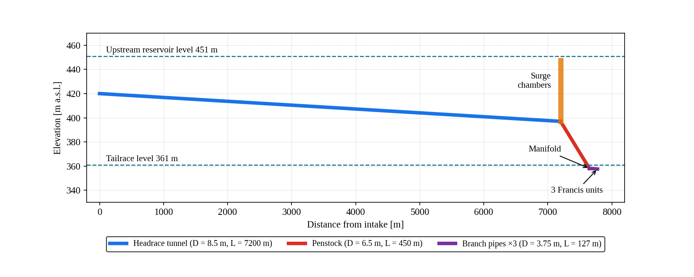

*Figure 1. Layout of the reference model (elevations along the waterway).*

---

# 2. Water hammer and surge in plain words

This chapter explains the physics without equations. You can skip it if you already know the topic.

## 2.1 Water hammer

Imagine water flowing in a long pipe from a reservoir to a valve. Suddenly the valve closes. The water next to the valve must stop, but the water behind it is still moving and pushes on it. The pressure at the valve rises sharply. This "pressure pulse" does not stay at the valve. It travels along the pipe like a sound wave, at a speed called the **wave speed**, usually 900 to 1300 m/s in tunnels and steel pipes.

The wave goes to the reservoir. The reservoir has constant level, so the wave reflects back with the opposite sign. This pattern repeats in four phases. The time for one full cycle is **4L/a**, where *L* is the pipe length and *a* the wave speed.

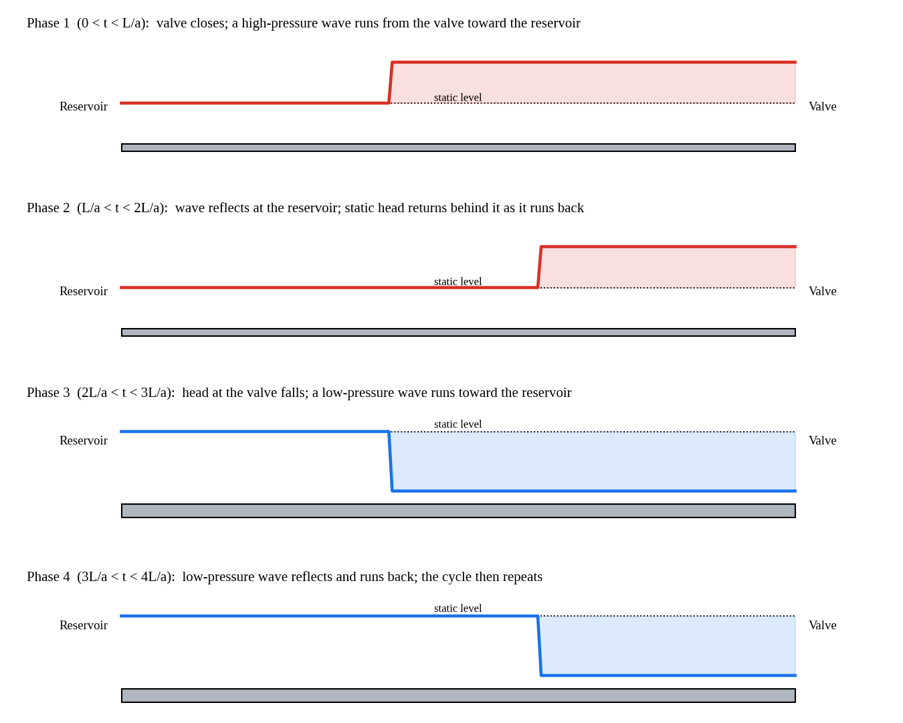

*Figure 2. The four phases of water hammer after a sudden valve closure. Red = pressure above static, blue = below static.*

The size of the first pressure rise for a very fast closure is given by the **Joukowsky formula**:

$$\Delta H = \frac{a\,\Delta V}{g}$$

In words: pressure rise (in metres of water) equals the wave speed times the change of velocity, divided by gravity. For a wave speed of 1250 m/s and a velocity change of 1.5 m/s the rise is about 195 m of water, almost 19 bar. This is why gate closing time matters.

**Slow closure reduces the rise.** If the closure takes longer than the wave round-trip time 2L/a, the reflected wave comes back before the closure ends and cancels part of the rise. For the penstock of the reference model, 2L/a is only about one second, while the gate takes 8 seconds. So the rise is much smaller than the Joukowsky value.

## 2.2 Negative pressures

After the high-pressure wave, a low-pressure wave follows (phase 3 in the figure). If the pressure falls below the pipe's own pressure limit, two bad things can happen:

- **Cavitation / column separation:** the water boils at low pressure and forms vapour bubbles. When the bubbles collapse, very high pressures appear.
- **Pipe collapse:** thin steel pipes can buckle under external pressure.

For this reason the **minimum pressure** is as important as the maximum.

## 2.3 Surge (mass oscillation)

A headrace tunnel can be many kilometres long and holds a huge amount of water. When the turbines close, this water cannot stop immediately. If there were no surge chamber, the pressure wave would bounce between the turbines and the upstream reservoir through the whole 7 km tunnel. A **surge chamber** is an open-top chamber near the end of the tunnel. It acts as a small reservoir close to the turbines:

- The fast pressure wave reflects at the surge chamber, so it does not need to travel the whole tunnel.
- The moving water in the tunnel fills the chamber slowly. The water level goes up, falls back, goes up again. This is the **mass oscillation**.

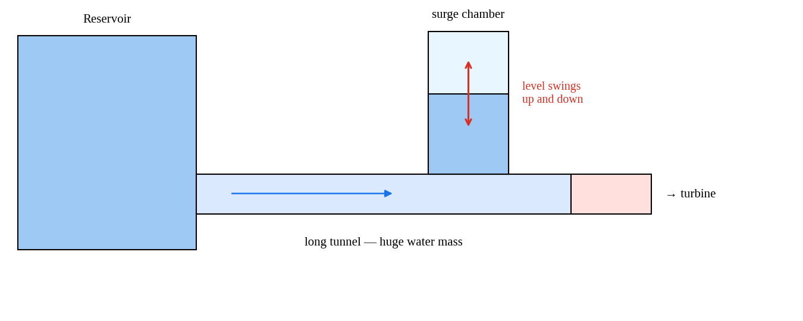

*Figure 3. After load rejection, the tunnel water flows into the surge chamber and the level swings up and down.*

The oscillation is slow (a period of several minutes) and is damped by friction and by the orifice at the bottom of the chamber. An orifice that is too large gives little damping and a large number of swings. An orifice that is too small gives strong damping but sends a large water-hammer wave back into the penstock (see chapter 12).

## 2.4 Load rejection and load acceptance

| Event | What happens | What you check |
|---|---|---|
| **Load rejection (LR)** | The grid disconnects, the gate closes | Maximum pressure in penstock and branches; maximum surge level |
| **Load acceptance (LA)** | The gate opens to supply power | Minimum pressure; minimum surge level (the chamber must not empty) |

Both events must be studied. The pressure envelope in this software always combines both ("worst case, LR + LA").

## 2.5 Why the Method of Characteristics

Water hammer needs a method that follows waves exactly. The **Method of Characteristics (MOC)** does this. It turns the two partial differential equations of the flow into simple ordinary equations that are valid along the paths of the waves. The method is accurate, easy to code, and handles complex boundaries such as surge chambers, manifolds and turbines. It is the standard method in transient analysis programs for hydropower. Chapter 4 shows the details.

---

# 3. Software overview

## 3.1 Architecture

The software has two layers:

- **engine/** — the numerical core. It has no window or plot code, so it can be run from a script or tested automatically.
- **gui/** — the Tkinter window, panels and Matplotlib figures.

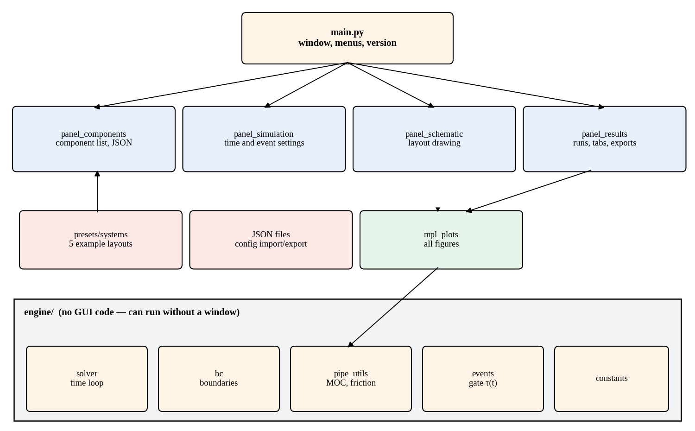

*Figure 4. Software architecture. The GUI calls the engine; the engine never calls the GUI.*

### Files and their jobs

| File | Job |
|---|---|
| `main.py` | Starts the window, builds menus, holds the version number |
| `engine/solver.py` | Reads the component list, sets the initial state, runs the time loop, builds the result dictionary |
| `engine/bc.py` | Boundary conditions: reservoirs, surge chamber, tee, manifold, turbine, valve, junction |
| `engine/pipe_utils.py` | Materials, wave speed, friction, pipe discretisation, interior MOC update |
| `engine/events.py` | Gate opening functions τ(t) |
| `engine/constants.py` | g, density, tolerances |
| `gui/panel_components.py` | Component list editor, JSON import and export |
| `gui/panel_simulation.py` | Time and event settings, gate preview |
| `gui/panel_schematic.py` | Layout drawing |
| `gui/panel_results.py` | Run buttons, tables, plot tabs, exports |
| `gui/mpl_plots.py` | All figures |
| `presets/systems.py` | Five example systems |
| `tests/` | Regression test and the reference configuration |

## 3.2 Data flow

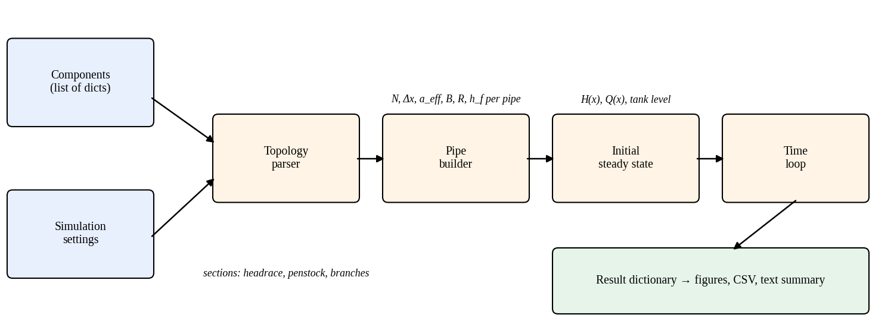

*Figure 5. From inputs to results.*

1. You give a **list of components** (a list of Python dictionaries, stored as JSON) and **simulation settings**.
2. The **topology parser** sorts the pipes into three sections: headrace (before the surge chamber), penstock (between surge chamber and manifold) and branches (after the manifold).
3. The **pipe builder** chooses the number of calculation points for each pipe and computes its constants.
4. The **initial state** is calculated so that the system starts in perfect steady flow.
5. The **time loop** advances the solution step by step.
6. A **result dictionary** is returned and used for figures, tables and files.

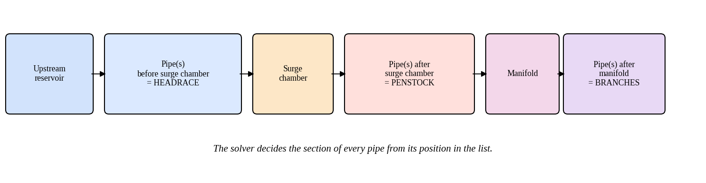

*Figure 6. How the solver divides the pipes into sections.*

## 3.3 Installation and start

```
python -m pip install -r requirements.txt     # numpy>=1.26, matplotlib>=3.8
python main.py                                 # starts the program
python tests/test_regression.py                # checks the engine
```

Tkinter is part of the standard Python installation on Windows. On Linux it may need a separate package (for example `python3-tk`).

## 3.4 Using the engine without the window

```python
import json
from engine.solver import run_simulation

cfg = json.load(open("tests/yogesh_config.json"))
sim = dict(cfg["sim"], tau_init=1.0, tau_final=0.0, ramp_type="Linear")
res = run_simulation(cfg["components"], sim)

print(res["Q0"])                              # initial discharge
print(res["component_analysis"][1]["P_max_bar"])   # penstock maximum pressure
print(res["model_warnings"])                  # [] if everything is fine
```

This is how the figures and tables in this document were produced.

## 3.5 Version 6 in one paragraph

Version 6 corrects the turbine boundary condition that gave a false start-up wave in version 5, makes the friction and rated-head reference independent of the starting gate opening, starts every run in true equilibrium, honours the wave-speed mode, adds an automatic steady-state check, and gives all figures a black Times New Roman style with legends below the plots. Chapter 13 shows the before-and-after evidence.

---

# 4. The mathematics

## 4.1 The two equations of unsteady pipe flow

Two unknowns change along the pipe and in time: the piezometric head *H* (water level the pipe pressure would lift water to, in m above sea level) and the discharge *Q* (m³/s).

**Continuity** (mass is conserved, water is slightly compressible and the pipe wall is slightly elastic):

$$\frac{\partial H}{\partial t} + \frac{a^{2}}{g A}\,\frac{\partial Q}{\partial x} = 0$$

**Momentum** (Newton's law for the water column, with wall friction):

$$\frac{\partial Q}{\partial t} + g A\,\frac{\partial H}{\partial x} + \frac{f}{2 D A}\,Q\,|Q| = 0$$

| Symbol | Meaning |
|---|---|
| *a* | wave speed [m/s] |
| *A* | flow area [m²] |
| *g* | gravity [m/s²] |
| *f* | Darcy–Weisbach friction factor [–] |
| *D* | diameter (hydraulic diameter for non-circular shapes) [m] |

The term *Q|Q|* keeps the friction force opposite to the flow direction.

## 4.2 Characteristic equations

The Method of Characteristics shows that the two equations are equivalent to four ordinary equations, valid along the lines *dx/dt = +a* (called C⁺) and *dx/dt = −a* (called C⁻). In the form used by the program:

$$C^{+}:\;\; H_P = C_P - B\,Q_P \qquad\qquad C^{-}:\;\; H_P = C_M + B\,Q_P$$

where the known constants from the previous time step are

$$C_P = H_{i-1} + B\,Q_{i-1} - R\,Q_{i-1}|Q_{i-1}|, \qquad C_M = H_{i+1} - B\,Q_{i+1} + R\,Q_{i+1}|Q_{i+1}|$$

and the two pipe constants are

$$B = \frac{a}{g A} \quad [\mathrm{s/m^{2}}], \qquad R = \frac{f\,\Delta x}{2 g\,D_h\,A^{2}} \quad [\mathrm{s^{2}/m^{5}}]$$

**What this means.** Information travels along the two diagonal lines. A new point P at node *i* is reached by a forward wave from node *i−1* and a backward wave from node *i+1*, both from the previous time level. Solving the two equations gives *H* and *Q* at P:

$$Q_P = \frac{C_P - C_M}{2B}, \qquad H_P = C_P - B\,Q_P$$

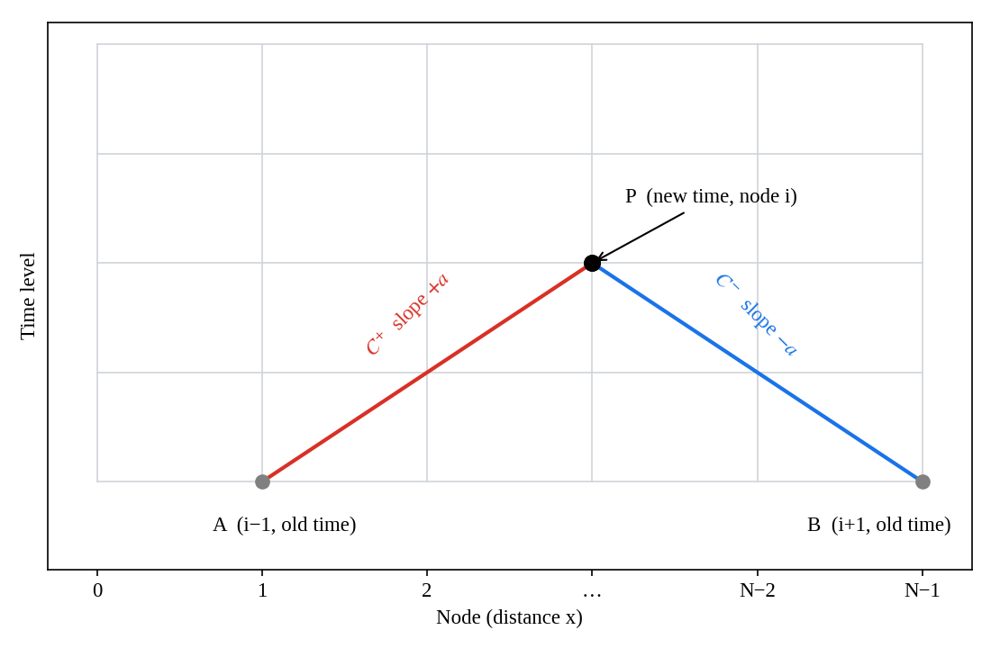

*Figure 7. The characteristic grid. The new values at P come from nodes A and B at the old time level.*

*B* is called the **pipe impedance**. A pipe with a high *B* (small area or high wave speed) produces large head changes for a given flow change. *R* is the **resistance coefficient**; it is zero for a frictionless pipe.

## 4.3 Wave speed

The wave speed depends on how stiff the pipe wall is. Two modes exist, set separately for every pipe:

- **manual:** you type the wave speed.
- **material:** the program uses the Korteweg–Joukowsky formula for a thin-walled elastic pipe:

$$a = \sqrt{\frac{K/\rho}{1 + \dfrac{K}{E}\,\dfrac{D}{e}\,c_1}}$$

| Symbol | Meaning | Value |
|---|---|---|
| *K* | bulk modulus of water | 2.05 GPa |
| *ρ* | density of water | 1000 kg/m³ |
| *E* | Young's modulus of the wall | steel 210 GPa, concrete 30 GPa, HDPE 0.9 GPa … |
| *D* | diameter | m |
| *e* | wall thickness | m |
| *c₁* | restraint factor | 0.91 if anchored (1 − 0.3²), 1.0 if free |

The result is limited to 200–1500 m/s. A rock-confined concrete tunnel is not a thin-walled pipe, so for it the material formula is not valid. For the material "Concrete (tunnel)" the program therefore uses the wave speed you type.

Typical values: steel penstock 1100–1300 m/s, lined tunnel 900–1200 m/s, HDPE 250–400 m/s.

## 4.4 Friction

The friction factor *f* is found by one of four methods, chosen for each pipe:

| Method | How *f* is found |
|---|---|
| `swamee_jain` (default) | Laminar *Re* < 2000: *f = 64/Re*. Otherwise Swamee–Jain explicit formula |
| `colebrook_white` | Colebrook–White equation solved by iteration |
| `manning` | Manning's *n* converted to a Darcy factor |
| `manual` | Your own value (must be greater than 0) |

The Swamee–Jain formula is

$$f = \frac{0.25}{\left[\log_{10}\!\left(\dfrac{\varepsilon}{3.7\,D_h} + \dfrac{5.74}{Re^{0.9}}\right)\right]^{2}}, \qquad Re = \frac{V\,D_h}{\nu}$$

with roughness *ε* (steel 0.046 mm, concrete 0.3 mm, shotcrete 0.5 mm) and kinematic viscosity *ν* = 10⁻⁶ m²/s.

Two things to know:

1. The friction factor is calculated **once at the rated discharge** and then kept constant. This is called *quasi-steady friction*.
2. The steady head loss of a pipe is *h_f = f L V² / (2 g D_h)*. This value sets the initial slope of the water line.

## 4.5 Non-circular tunnels

Drill-and-blast tunnels are often D-shaped or horseshoe-shaped. The program accepts `D-Shape` and `Horseshoe` with the springline width *D* and the straight wall height *h*:

$$A = D\,h + \frac{\pi}{2}R^{2}, \qquad P = D + 2h + \pi R, \qquad D_h = \frac{4A}{P}, \qquad R = \frac{D}{2}$$

The real area *A* is used for velocity. The hydraulic diameter *D_h* is used for friction and Reynolds number.

## 4.6 Effective area of an inclined surge pipe

A surge pipe that is inclined by an angle θ from horizontal needs a longer length of water for the same level change, so it behaves like a **bigger tank**:

$$A_{\mathrm{eff}} = \frac{n_{\mathrm{tanks}}\,\pi D_{\mathrm{tank}}^{2}/4}{\sin\theta}$$

For the reference model: two pipes of 6.5 m diameter and θ = 8.13° give

$$A_{\mathrm{eff}} = \frac{2 \times 33.18}{\sin 8.13^{\circ}} = 469.3\ \mathrm{m^{2}}$$

A vertical shaft has θ = 90° and *A_eff* equals the real area. Angles below 1° trigger a warning.

## 4.7 Pressure from head

Gauge pressure at any point is calculated from the head and the **pipe invert** elevation:

$$P\ [\mathrm{bar}] = \frac{\rho\,g\,(H - z_{\mathrm{invert}})}{10^{5}}$$

This is why the invert elevations (`z_start`, `z_end`) are important input. Without them the program falls back to the tailrace level, and the pressure plots are not correct.


# 5. The numerical method

## 5.1 The grid

Each pipe is cut into equal reaches. The calculation points are called **nodes**. All pipes use the **same time step Δt**, and the number of reaches is chosen so that a wave travels exactly one reach in one time step. This is the Courant condition for MOC:

$$N = \mathrm{round}\!\left(\frac{L}{a\,\Delta t}\right) + 1, \qquad \Delta x = \frac{L}{N-1}, \qquad a_{\mathrm{eff}} = \frac{\Delta x}{\Delta t}$$

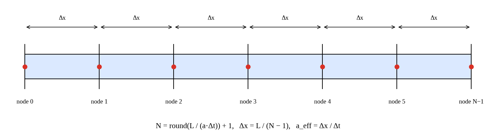

*Figure 8. Pipe divided into N nodes. The wave speed used in the calculation is Δx/Δt.*

**Important consequence.** Because *N* must be a whole number, the wave speed used in the calculation (*a_eff*) is slightly different from the number you typed. For long pipes the difference is tiny (the 7200 m tunnel changes by 0.2 %). For short pipes it can be large: the 127 m branch pipe below changes by more than 10 %, because it only has 4 nodes. The program always reports the wave speed actually used in the Component Analysis table. The grid check in section 5.5 shows how much this matters for the results.

For the reference model with Δt = 0.0355 s:

| Pipe | Length [m] | Source of *a* | *a* before rounding [m/s] | Nodes *N* | *a_eff* used [m/s] | Difference |
|---|--:|---|--:|--:|--:|--:|
| Headrace Tunnel | 7200 | typed value | 1000.0 | 204 | 998.3 | -0.2 % |
| Penstock | 450 | Korteweg–Joukowsky | 1311.2 | 11 | 1266.5 | -3.4 % |
| Branch Pipe | 127 | Korteweg–Joukowsky | 1358.4 | 4 | 1191.5 | -12.3 % |

## 5.2 Automatic time-step reduction

Every pipe needs at least 3 nodes. If the requested Δt is too large for the shortest pipe, the program lowers it and shows a warning. The limit is

$$\Delta t_{\max} = \min_i \frac{L_i}{a_i\,(N_{\min} - 0.5)}, \qquad N_{\min} = 3$$

In the reference model the 127 m branch pipe forces the time step down from 0.05 s to 0.0355 s. This is normal and is not an error.

## 5.3 One time step in eight actions

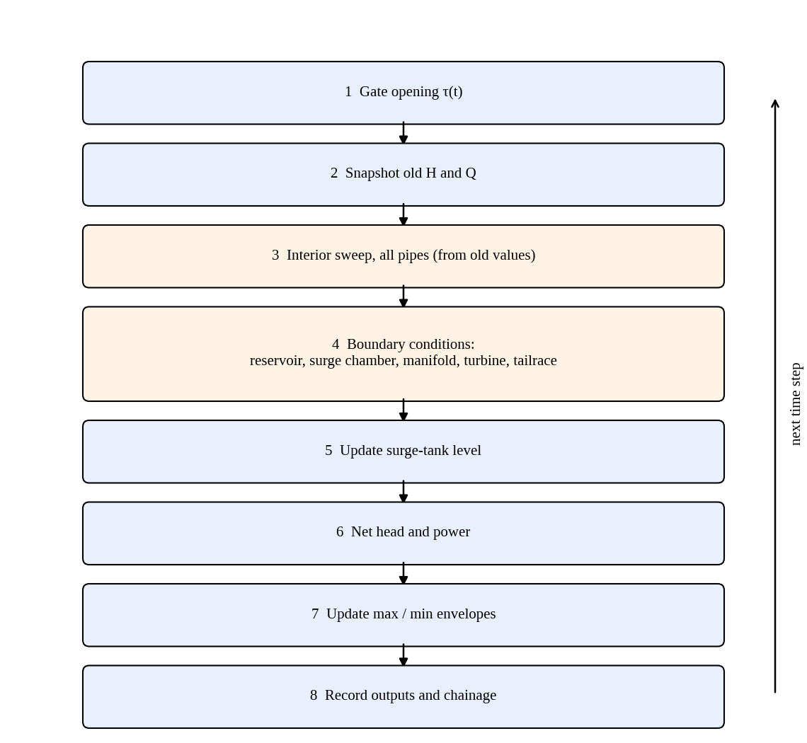

*Figure 9. The sequence of calculations in every time step.*

1. **Gate opening.** Compute τ(t) from the event definition.
2. **Snapshot.** Copy all heads and flows (old time level).
3. **Interior sweep.** For every pipe, compute the new *H* and *Q* at all inner nodes from the old values, using the characteristic equations. This is done for all nodes at once with NumPy arrays, so it is fast.
4. **Boundary conditions.** Compute the new values at pipe ends: reservoirs, surge chamber, junctions, manifold, turbines, tailrace. They use the old values of the neighbouring nodes.
5. **Surge level.** Update the water level in the surge chamber.
6. **Net head and power.**
7. **Envelopes.** Update the stored maximum and minimum head at every node.
8. **Record.** Save the scalar outputs and the chainage histories.

**Why the order matters.** In version 4.1 the boundary conditions wrote new values before the interior sweep had read the old ones. The interior then used a mixture of old and new values and produced false oscillations. Since version 4.2 the interior sweep always happens first, from a snapshot.

## 5.4 Surge level update

The chamber level is advanced with a simple explicit step:

$$H_{st}^{\,n+1} = H_{st}^{\,n} + \frac{Q_{st}\,\Delta t}{A_{\mathrm{eff}}}$$

*Q_st* is positive when water flows from the junction into the chamber. The step is small compared to the oscillation period (0.036 s against about 490 s), so the explicit step is accurate.

## 5.5 How accurate is the time step? (grid convergence)

A good numerical result must not depend strongly on Δt. The reference model was run with four requested time steps (the first was reduced automatically, see above). Only the first pressure peak after the event is needed, so these runs end at 260 s.

| Requested Δ*t* [s] | Used Δ*t* [s] | Penstock *P*max [bar] | Branch *P*max [bar] | Branch *P*min [bar] |
|--:|--:|--:|--:|--:|
| 0.05 | 0.0355 | 12.348 | 13.001 | 6.699 |
| 0.02 | 0.0200 | 12.362 | 13.067 | 6.547 |
| 0.01 | 0.0100 | 12.365 | 13.106 | 6.506 |
| 0.005 | 0.0050 | 12.370 | 13.131 | 6.486 |

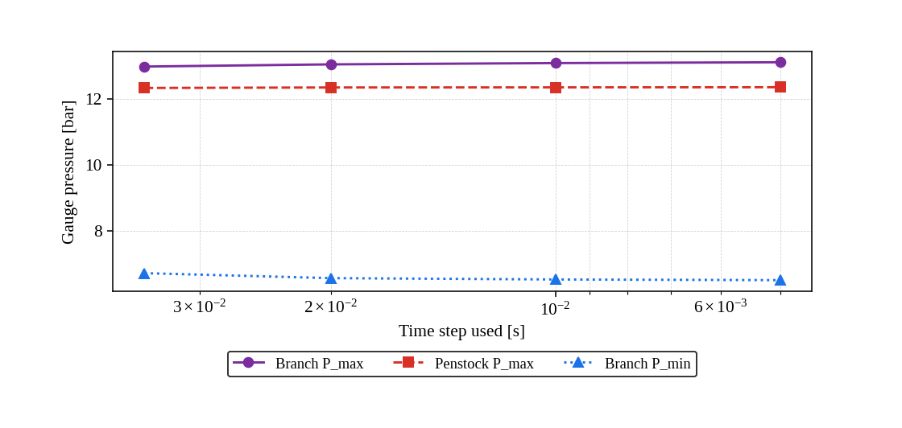

*Figure 10. Pressure results against the time step used. The values change by about 1 % (maximum) and 3 % (minimum) over a factor of 7 in Δt.*

The maximum pressure in the branch changes by only about 1 % and the minimum by about 3 %. **Conclusion:** the default Δt of 0.05 s (automatically reduced to 0.036 s) is adequate for screening. Because short pipes such as the 127 m branch have their wave speed changed by the grid, the pressure at the turbine is the most sensitive result. For final design, repeat the run with Δt = 0.01 s or smaller and check that the answer does not move.

---

# 6. Component and boundary-condition models

In this chapter *C_P* is the constant of the C⁺ line coming from the upstream neighbour, *C_M* the constant of the C⁻ line coming from the downstream neighbour, and *B* the impedance of the pipe at that end.

## 6.1 Reservoirs

A reservoir keeps its level constant. At the pipe end, *H = H_res*. The discharge follows from the characteristic equation. The input `H` is a **level above sea level**, not a depth.

## 6.2 Pipes

Pipes are the only components with their own nodes. Their input data are length, diameter, invert elevations, wave-speed mode, friction method and shape. They are described in chapters 4 and 5.

## 6.3 Pipe junction (bend, change of diameter, minor loss)

A junction between two pipes can have a minor loss with coefficient *K*:

$$H_{\mathrm{down}} = H_{\mathrm{up}} - \frac{K\,Q\,|Q|}{2\,g\,A^{2}}$$

With *K = 0* the head is the same on both sides. A pipe junction can sit between any two pipes in any section.

## 6.4 Surge chamber

The surge chamber is placed between the headrace and the penstock. Types `Surge Tank` (vertical), `Surge Tunnel` and `Surge Chamber` use the same model.

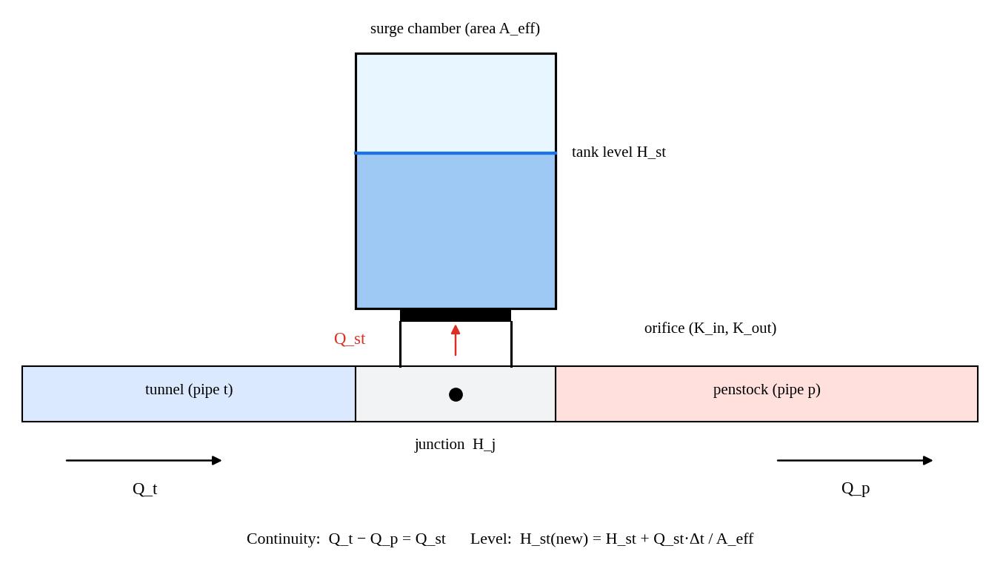

*Figure 11. Surge chamber model: junction head H_j, orifice, and tank level H_st.*

### Simple mode

If the orifice is as large as the tank (area ratio ≥ 0.95) or both loss coefficients are almost zero, the tank level is the junction head:

$$H_j = H_{st}, \qquad Q_t = \frac{C_P - H_j}{B_t}, \qquad Q_p = \frac{H_j - C_M}{B_p}, \qquad Q_{st} = Q_t - Q_p$$

### Throttled mode (normal case)

An orifice between the junction and the tank causes a head loss. The flow through it is

$$Q_{or} = \mathrm{sign}(\Delta H)\,A_{or}\sqrt{\frac{2\,g\,|\Delta H|}{K}}, \qquad \Delta H = H_j - H_{st}$$

*K* is *K_in* when water enters the tank and *K_out* when it leaves. The junction head follows from continuity:

$$F(H_j) = \frac{C_P - H_j}{B_t} - \frac{H_j - C_M}{B_p} - Q_{or}(H_j) = 0$$

*F* always decreases when *H_j* increases, so the root is unique. The program solves it with **Newton's method protected by bisection**: a Newton step is accepted only if it stays inside the bracket and at least halves it. Otherwise the program bisects. The solution cannot diverge, even if the orifice is only lightly throttled.

### Optional connecting shaft

If `L_shaft > 0`, the chamber is connected to the main line through a pipe of that length, with its own wave speed and friction. The main flow then passes a lossless **tee junction**. With `L_shaft = 0` (default) the chamber sits directly at the junction.

### Design limits

`H_min` and `H_max` are **checks only**. If the level goes outside, the program shows a warning ("tank may run dry" or "may overflow") but lets the calculation continue.

## 6.5 Manifold

A manifold splits the penstock flow into *n_b* identical branches. All branch inlets have the same head, and the branch flows add up to the penstock flow:

$$H_M = \frac{\sum_{b} C_{M,b}/B_b + C_P/B_p}{n_b/B_b + 1/B_p}, \qquad Q_p = \sum_{b} Q_b$$

## 6.6 Turbine

The turbine is modelled as a **gate (orifice)** whose discharge depends on the head and the gate opening τ:

$$Q_t = \tau\,Q_{\mathrm{ref}}\,\sqrt{\frac{H_t - H_{\mathrm{tail}}}{H_{\mathrm{rated}}}}$$

where *Q_ref = Q_rated / n_units* is the rated discharge of one unit and *H_rated* is the rated net head. The turbine inlet head must also satisfy the pipe's characteristic equation:

$$H_t = C_P - B_b\,Q_t$$

### The closed-form solution

Put the second equation into the first and square it. With *k = (τ Q_ref)² / H_rated* you get a quadratic equation in *Q_t*:

$$Q_t^{2} + k\,B_b\,Q_t - k\,(C_P - H_{\mathrm{tail}}) = 0 \quad\Longrightarrow\quad Q_t = \frac{-k B_b + \sqrt{(k B_b)^{2} + 4k\,(C_P - H_{\mathrm{tail}})}}{2}$$

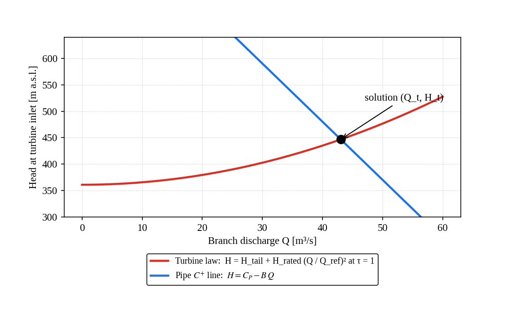

*Figure 12. The solution is the crossing point of the turbine law (red) and the pipe characteristic line (blue).*

This is exact; no iterations are needed. If *C_P ≤ H_tail* or the gate is closed, then *Q_t = 0*; reverse flow is not allowed.

> **Why this matters.** Version 5 solved the same equation with a Newton iteration that clamped the head at zero. When the pipe term *B·Q* is large (here about 473 m), the iteration jumped into the clamped region and converged to a wrong answer (Q = 158 m³/s instead of 129 m³/s). Chapter 13 shows the effect.

### Power

$$P = \frac{\rho\,g\,(\bar H_t - H_{\mathrm{tail}})\,\sum Q_t\,\eta}{10^{6}}\ [\mathrm{MW}], \qquad P_{\mathrm{rated}} = \frac{\rho\,g\,H_{\mathrm{rated}}\,Q_{\mathrm{rated}}\,\eta}{10^{6}}$$

The efficiency η is constant. The units move together.

### Pelton turbines

Pelton turbines use the same law with `H_tail` read as the nozzle elevation. The fields `n_jets`, `Cv_needle` and `D_jet` are stored but do not change the law. A detailed jet and deflector model is not in version 6.

### Layouts without a manifold

If there are no branch pipes, the turbine boundary is placed on the end of the last pipe and the full rated discharge is used.

## 6.7 Tailrace

A short stub pipe ends in the downstream reservoir. It only provides a clean downstream boundary and is not reported.

## 6.8 Valve

The engine contains a valve boundary (*Q = τ·C_v·√ΔH*), but the current time loop does not call it. A `Valve` component can be added in the window, but it **has no effect** on the results in version 6. See chapter 14.

---

# 7. Gate events and initial conditions

## 7.1 Gate opening τ(t)

τ is the gate opening as a fraction from 0 (closed) to 1 (fully open). A single ramp starts at *t_start* and takes *t_ramp*. With *p = min{(t − t_start)/t_ramp, 1}*:

| Profile | τ(t) for t ≥ t_start |
|---|---|
| Linear | τ_i + p (τ_f − τ_i) |
| Cosine | τ_i + (τ_f − τ_i) · ½ [1 − cos(π p)] |
| Step | τ_f |

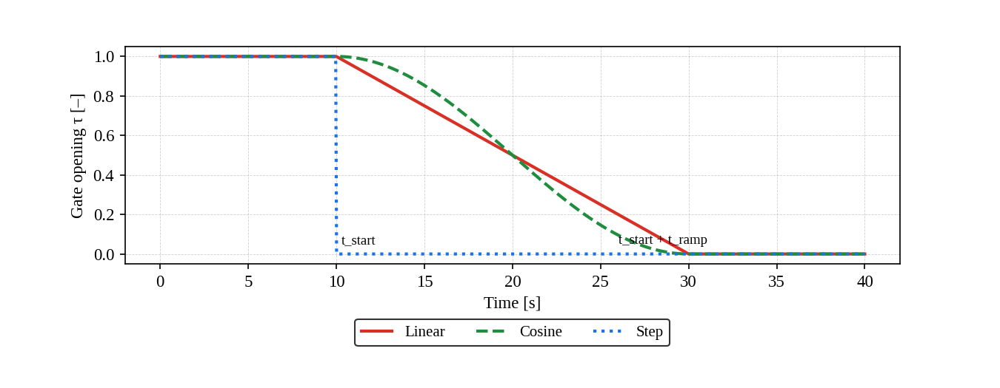

*Figure 13. The three gate profiles for a closing gate (start 10 s, ramp 20 s).*

The linear profile is typical for load rejection. The cosine profile starts and ends gently and is used for load acceptance in this program.

**What the window's run buttons do.** *Load Rejection* uses τ: 1 → 0 with a **linear** ramp. *Load Acceptance* uses τ: 0 → 1 with a **cosine** ramp. The start time and ramp time come from the Simulation panel. The ramp-profile choice in that panel affects only the preview. Other events can be run from Python by passing `tau_init`, `tau_final` and `ramp_type`, or a list of `EventSegment` objects.

## 7.2 Why the initial state matters

A transient calculation must start from a **steady state**. If the first time step is not in equilibrium, the program creates a false wave that looks like a real transient. Version 6 builds the starting state carefully.

## 7.3 How the initial state is built

1. **Pipes are built at the rated discharge.** Friction factor, impedance and head loss are computed for *Q_rated* (branches for *Q_rated/n_b*), not for the discharge at the starting gate opening.
2. **Rated net head.** *H_rated = (H_up − H_dn) − Σ h_f,r*.
3. **Starting discharge for any initial opening τ₀.** The turbine law and the losses (*h_f ∝ Q²*) give

$$\frac{Q_0}{Q_{\mathrm{rated}}} = \tau_0\,\sqrt{\frac{H_{up} - H_{dn}}{H_{\mathrm{rated}} + \tau_0^{2}\,\sum h_{f,r}}}$$

For τ₀ = 1 this gives exactly 1. For τ₀ = 0.5 it gives the right discharge for half-open gates, so partial-gate events also start in equilibrium.

4. **Heads** change linearly along each pipe by its friction loss.
5. **Surge level** starts at the junction head, unless you give `H_st_init` greater than 0.

For the reference model:

| Quantity | Value |
|---|---|
| Static head *H_up − H_dn* | 90.00 m |
| Rated net head *H_rated* | 85.72 m |
| Initial discharge, load rejection (τ₀ = 1) | 129.13 m³/s |
| Initial discharge, load acceptance (τ₀ ≈ 0) | about 0 m³/s |
| Initial surge level (load rejection) | 447.65 m a.s.l. |
| Rated power | 97.96 MW |

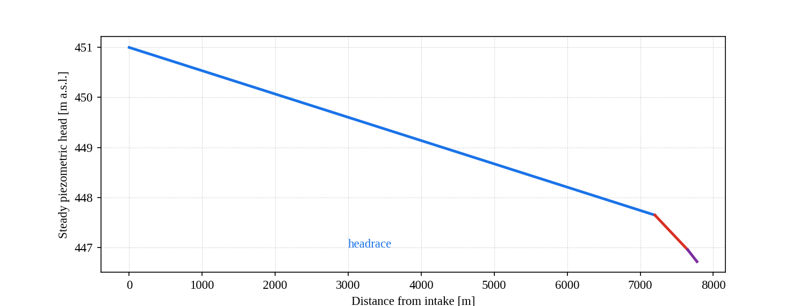

*Figure 14. Steady-state water line (piezometric head) of the reference model before the event.*

## 7.4 Partial-gate events start in equilibrium

The two runs below start with the gate at 0.5. Both begin at a discharge of 65.75 m³/s and stay flat until the event at 200 s. One closes to 0, the other opens to 1.

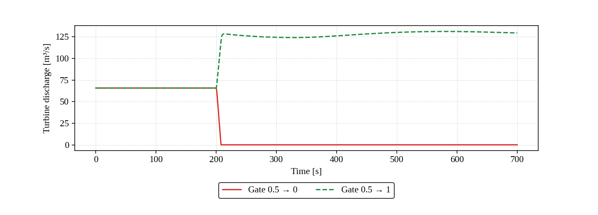

*Figure 15. Turbine discharge for partial-gate events: gate 0.5 → 0 and 0.5 → 1.*

## 7.5 Automatic steady-state check

Before the event, the program compares the turbine discharge with the starting discharge and the junction head with its starting value. If the discharge drifts by more than 1 % or the head by more than 0.5 m, it adds a message to `model_warnings` and the window shows a **Model Check** dialog. If this dialog appears, **do not use the results**. Look for wrong inputs such as an inconsistent rated discharge, missing invert elevations or a very small time step.

---

# 8. Input reference

Units: lengths in m, elevations in m a.s.l., discharges in m³/s, times in s.

## 8.1 Order of components

The list is read from top to bottom:

1. One **upstream reservoir** (required).
2. **Pipes** before the surge chamber → headrace section.
3. **Surge chamber** (optional).
4. **Pipes** after the surge chamber → penstock section.
5. **Manifold** (optional).
6. **Pipes** after the manifold → branch section.
7. **Turbine** (required).
8. One **downstream reservoir** (required).

Only the **first** surge chamber, manifold and turbine are used. At least one pipe is required.

## 8.2 Reservoirs

| Key | Meaning | Reference model |
|---|---|---|
| `H` | Water level [m a.s.l.] | 451.0 (up), 361.0 (down) |
| `z_base` | Bed elevation (display only) | 420.0, 361.0 |

## 8.3 Pipe

| Key | Meaning | Allowed values |
|---|---|---|
| `L`, `D` | Length, diameter (springline width for D-shape) | > 0 |
| `z_start`, `z_end` | Invert elevation at upstream and downstream end | any |
| `wave_mode` | How the wave speed is found | `manual`, `material` |
| `a` | Wave speed for `manual` (also used for materials without modulus) | 200 – 1500 |
| `material` | Pipe material | Steel, Concrete, Concrete (shotcrete), Concrete (tunnel), HDPE, Cast Iron, GRP/FRP, Custom |
| `thickness`, `anchored` | Wall thickness; restraint | m; true / false |
| `flow_type` | Friction law family | `pressurised`, `open` |
| `friction_method` | Friction factor method | `swamee_jain`, `colebrook_white`, `manning`, `manual` |
| `n_mann`, `f_manual` | Manning *n*; manual Darcy *f* | e.g. 0.015; > 0 |
| `shape`, `wall_height` | Section shape; straight-wall height | `Circular`, `D-Shape`, `Horseshoe`; ≥ 0 |

## 8.4 Pipe junction

| Key | Meaning |
|---|---|
| `K_loss` | Minor-loss coefficient referenced to the upstream pipe area |
| `description` | Free text (e.g. bend) |
| `z_invert` | Invert elevation |

## 8.5 Surge chamber

| Key | Meaning | Reference model |
|---|---|---|
| `D_tank`, `n_tanks` | Diameter of one tank, number of tanks | 6.5 m, 2 |
| `theta_deg` | Inclination from horizontal (90 = vertical) | 8.13 |
| `D_orifice` | Orifice diameter | 4.0 m |
| `K_in`, `K_out` | Loss coefficients for inflow and outflow | 1.5625, 2.0408 |
| `H_min`, `H_max` | Design check limits | 200, 1000 m |
| `H_st_init` | Initial level (0 = use junction head) | 0 |
| `z_base` | Tank base elevation | 397 m |
| `L_shaft`, `D_shaft`, `a_shaft` | Optional connecting shaft | 0 (none) |

The shaft can also have `n_mann_shaft`, `friction_method_shaft`, `f_manual_shaft`, `material_shaft`, `wave_mode_shaft`, `thickness_shaft` and `anchored_shaft`.

## 8.6 Manifold

| Key | Meaning |
|---|---|
| `n_branches` | Number of branches |
| `z_invert` | Invert elevation |

## 8.7 Turbine

| Key | Used in the calculation? | Meaning |
|---|---|---|
| `turb_type` | yes | `Francis`, `Kaplan`, `Pelton` (all use the same law) |
| `n_units` | yes | Number of units |
| `Q_rated` | yes | **Total** rated discharge (all units together) |
| `eta` | yes | Constant efficiency |
| `n_jets`, `Cv_needle` | passed on, no effect on the law | Pelton data |
| `z_centreline`, `n_gv`, `D_runner`, `D_jet` | no | Stored for documentation |

## 8.8 Valve

`Cv`, `z_invert`. Stored but not simulated in version 6.

## 8.9 Simulation settings

| Key | Meaning | Reference model |
|---|---|---|
| `T_end` | Total simulated time | 1000 s |
| `dt` | Requested time step | 0.05 s |
| `g` | Gravity | 9.81 |
| `t_start`, `t_ramp` | Event start and duration | 200 s, 8 s |
| `tau_init`, `tau_final`, `ramp_type` | Gate settings (the window's LR/LA buttons set their own) | 1 → 0, Linear |

## 8.10 How long should the simulation be?

A surge oscillation has a period of about 490 s here. To see at least the first maximum and the first minimum after the event you need about 1.5 periods, and 2–3 periods to see the damping. With the event at 200 s this means **T_end of 1000 s or more**. For water-hammer only, 300 s is enough.

---

# 9. Output reference

## 9.1 Time series

Every array has *T_end/Δt + 1* values.

| Key | Meaning |
|---|---|
| `time`, `tau` | Time; gate opening |
| `H_junction` | Head at the surge junction [m a.s.l.] |
| `Q_pre` | Discharge at the downstream end of the headrace |
| `H_surge_tank`, `Q_surge_tank` | Chamber level; flow into the chamber |
| `H_penstock`, `Q_penstock` | Head at the penstock start; flow at its end |
| `H_manifold`, `H_orifice` | Manifold head; head at the chamber orifice |
| `H_turbine`, `Q_turbine` | Mean turbine inlet head; total turbine discharge |
| `net_head`, `power_MW` | *H_t − H_tail*; electrical power |

## 9.2 Spatial results

| Key | Meaning |
|---|---|
| `x_pre`, `x_post`, `x_bra` | Node distances in each section |
| `z_pre`, `z_post`, `z_bra` | Pipe invert elevations at the nodes |
| `env_*_max`, `env_*_min` | Maximum and minimum head at every node over the whole run |
| `nwl_*` | Steady-state water line (before the event) |
| `chainage_x_*`, `chainage_H_*` | Head against time at up to about 200 nodes per section |

## 9.3 Component analysis (per pipe)

Length, diameter, area, hydraulic diameter, material, flow type, friction method, **effective wave speed**, steady velocity, Reynolds number, friction factor, steady head loss, maximum and minimum head, maximum and minimum gauge pressure.

## 9.4 Messages

| Key | When it appears |
|---|---|
| `model_warnings` | The model is not in steady state before the event |
| `surge_warnings` | The chamber level leaves `H_min` or `H_max` |
| Python `RuntimeWarning` | Time step reduced; invalid angle; unknown material; invalid manual friction; non-circular wave-speed approximation |

## 9.5 Files you can export from the window

| Export | Content |
|---|---|
| Full results CSV | Time series of 13 variables |
| Pipe pressures | Head and pressure every about 10 m along every pipe |
| Results summary | Text file with the main numbers |
| Figures | PNG image of any plot |


# 10. User guide

## 10.1 The window

Start the program with `python main.py`. The title bar shows the version.

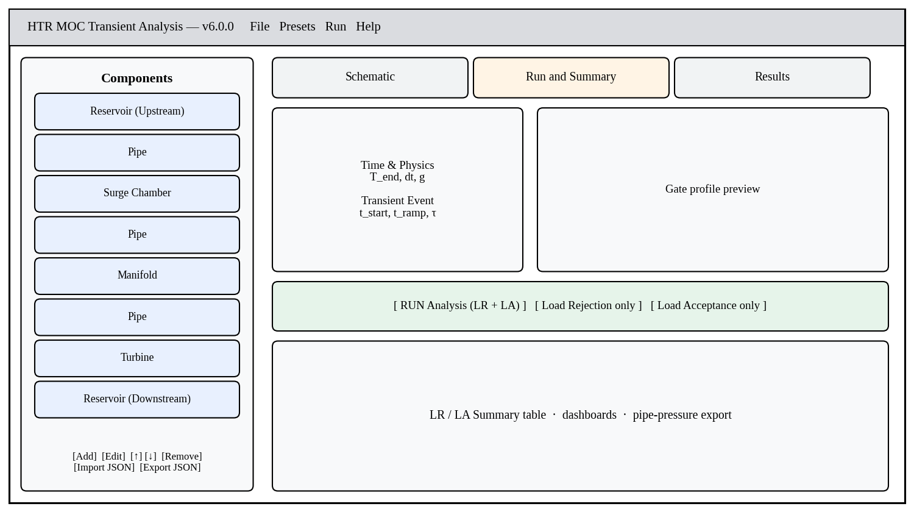

*Figure 16. Layout of the main window (schematic).*

| Area | What it contains |
|---|---|
| **Left: Components** | The list of components, with buttons to add, edit, remove and reorder, and to import or export a JSON file |
| **Right: Schematic** | A drawing of the current layout |
| **Right: Run and Summary** | Time and event settings, the gate preview, the run buttons, the progress bar, the LR / LA summary table and the dashboards |
| **Right: Results** | Variable plots, pressure envelopes, chainage plots, the component-analysis table and the CSV data |
| **Menu: File** | Export and import configuration (JSON), exit |
| **Menu: Presets** | The five built-in examples |
| **Menu: Run** | Run LR + LA, LR only, LA only |
| **Menu: Help** | About (version and build date) |

## 10.2 Step-by-step workflow

1. **Start from a preset** (menu *Presets*) or from the reference file (*File → Import Config JSON*). It is easier to change a working model than to start from nothing.
2. **Check the order** of the components: reservoir, pipes, surge chamber, pipes, manifold, pipes, turbine, reservoir.
3. **Edit each pipe.** Enter length, diameter, **both invert elevations**, wave-speed mode and friction method. Choose `manual` if you have a measured or design wave speed.
4. **Edit the surge chamber.** Enter diameter, number of tanks, inclination, orifice diameter, loss coefficients and the level limits.
5. **Edit the turbine.** Enter type, number of units, **total** rated discharge and efficiency. Make sure the number of manifold branches equals the number of units.
6. **Open the simulation settings.** Set `T_end` (1000 s or more for surge), `dt` (0.05 s is a good start), and the event start and ramp time.
7. **Press *RUN Analysis (LR + LA)*.** The progress bar shows the progress. A run of 1000 s with the reference model takes about 12 seconds on an ordinary computer for each event.
8. **Read the summary table** and the **Component Analysis** table. Check that the effective wave speeds and velocities are sensible.
9. **Look at the plots** (section 10.4).
10. **Export** what you need (section 10.5), and save the configuration (*File → Export Config JSON*).

## 10.3 What the run buttons do

| Button | Gate movement |
|---|---|
| RUN Analysis (LR + LA) | Runs both events one after the other |
| Load Rejection only | τ: 1 → 0, linear ramp |
| Load Acceptance only | τ: 0 → 1, cosine ramp |

The event start time and ramp time are taken from the Simulation panel.

## 10.4 Reading the plots

### Dashboard

The dashboard shows eight panels for one event pair: surge level, orifice flow, junction and penstock head, system discharge, net head and gate opening, power, penstock head envelope and surge-level envelope. Red lines are load rejection, green dashed lines are load acceptance. The legends are below each panel.

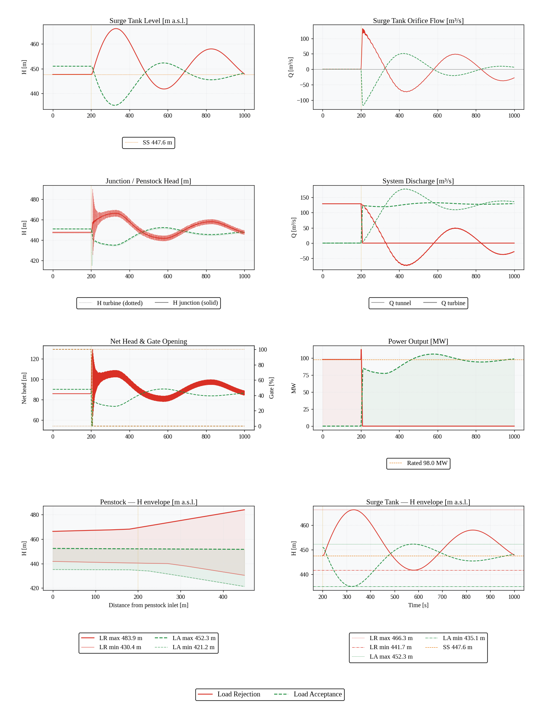

*Figure 17. Dashboard for the reference model (load rejection in red, load acceptance in green).*

### Pressure envelope

The *Pressure Envelope* tab has one sub-tab for the whole pipeline and one for each section. Each has two views: head in metres above sea level and gauge pressure in bar.

- The **orange dash-dot line** is the steady water line before the event.
- The **red line** is the highest value that occurred at each point in either event.
- The **blue line** is the lowest value.
- **Vertical dashed lines** separate the headrace, penstock and branch.
- The **green dotted line** at 0 bar shows where the pressure equals the atmosphere. If the blue line falls below it, the pipe sees negative gauge pressure.

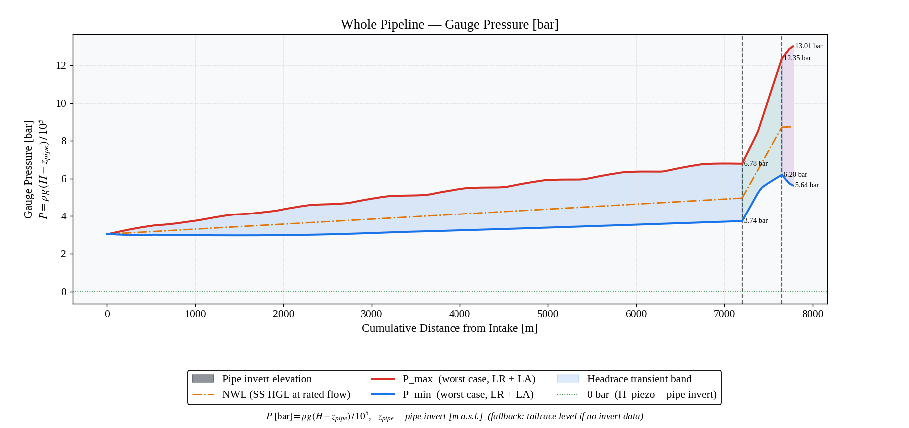

*Figure 18. Whole-pipeline pressure envelope for the reference model (worst case of load rejection and load acceptance).*

### Chainage plots

The *Chainage H(t)* tab shows the head against time at points you choose. Enter distances from the start of the section (for example 100, 3500, 7200 m) and press *Plot*. The program uses the nearest node and prints its real position in the title.

### Single variables

The *Variable* tab can show any time series with the LR and LA results together.

## 10.5 Exports

| Button | File | Use |
|---|---|---|
| Export CSV | `.csv` with 13 columns | Further analysis in Excel or Python |
| Pipe pressures | `.csv` | Head and pressure about every 10 m along each pipe |
| Save summary | `.txt` | Short report of the main results |
| Save figure | `.png` | Figures for reports |

## 10.6 Good habits

- **Always** enter invert elevations. They set the pressure scale.
- **Always** check the *Component Analysis* table for the effective wave speed.
- **Check that the Model Check dialog does not appear.**
- **Change one thing at a time** and compare. The sensitivity studies in chapter 12 show how.
- **Save the configuration file** with every report, so the result can be repeated.
- Make the run long enough (1000 s or more) when you want to see the surge extremes.

## 10.7 Common mistakes

| Mistake | Effect | How to avoid |
|---|---|---|
| `Q_rated` entered per unit instead of total | Discharge and head loss are wrong | `Q_rated` is the total of all units |
| Number of manifold branches differs from number of units | Flow is split wrongly | Use the same number |
| Invert elevations left at default | Wrong gauge pressures | Enter the real inverts |
| Wave speed mode `material` for a rock tunnel | Not valid for thick, confined linings | Use `manual` or the material "Concrete (tunnel)" with your own `a` |
| Very short pipe with a large time step | Time step is cut automatically | Accept it, or lengthen the pipe in the model |
| Surge chamber `H_min`/`H_max` set very wide | No warnings | Enter the real limits of the chamber |
| `theta_deg` of 0 for a chamber | Treated as 90° (warning) | Enter the real inclination |

---

# 11. Worked example: the reference model

## 11.1 Setting up

The model is described in section 1.4 and stored in `tests/yogesh_config.json`. Load it with *File → Import Config JSON*. The gate starts to move at 200 s. Closing takes 8 s (linear) and opening 8 s (cosine).

## 11.2 Initial state

| Quantity | Value |
|---|---|
| Rated net head | 85.72 m |
| Rated discharge (total) | 129.13 m³/s |
| Rated power | 97.96 MW |
| Time step used | 0.0355 s (28146 steps in 1000 s) |
| Initial surge level | 447.65 m a.s.l. |

## 11.3 Component analysis

| Pipe | *L* [m] | *D* [m] | *A* [m²] | *V* [m/s] | *Re* [10⁶] | *f* | *h_f* [m] | *a_eff* [m/s] | *H*max [m] | *H*min [m] | *P*max [bar] | *P*min [bar] |
|---|--:|--:|--:|--:|--:|--:|--:|--:|--:|--:|--:|--:|
| Headrace Tunnel | 7200 | 8.50 | 56.75 | 2.28 | 19.3 | 0.0150 | 3.35 | 998.3 | 467.5 | 441.0 | 6.81 | 2.99 |
| Penstock | 450 | 6.50 | 33.18 | 3.89 | 25.3 | 0.0130 | 0.69 | 1266.5 | 483.9 | 430.4 | 12.35 | 4.39 |
| Branch Pipe | 127 | 3.75 | 11.04 | 3.90 | 14.6 | 0.0090 | 0.24 | 1191.5 | 490.1 | 425.3 | 13.01 | 6.66 |

How to read this table:

- The **velocity** in the tunnel is only 2.28 m/s, because the tunnel is large. The velocity in the penstock and branches is about 3.9 m/s.
- The **head loss** in the tunnel is 3.35 m. This is only 3.7 % of the 90 m gross head.
- The **Reynolds numbers** are of the order of 10⁷, so the flow is fully turbulent and the friction factors do not change much with discharge.
- The **wave speeds** actually used are 998 m/s (tunnel), 1267 m/s (penstock) and 1191 m/s (branch).

## 11.4 Load rejection

The gate closes from 200 s to 208 s.

### Surge chamber

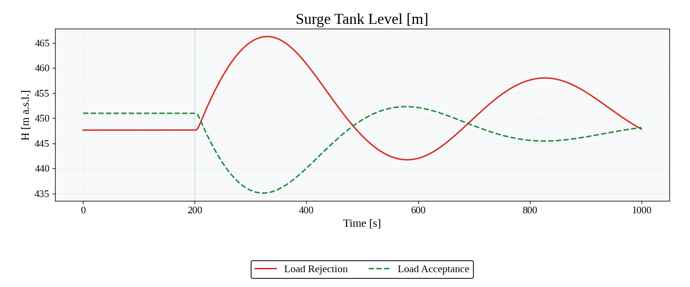

*Figure 19. Surge chamber level for load rejection (red) and load acceptance (green).*

| Quantity (load rejection) | Value |
|---|---|
| First maximum level | 466.28 m at 331 s |
| First minimum level after the maximum | 441.74 m at 580 s |
| Second maximum level | 458.03 m at 827 s |
| Observed oscillation period | 496 s |
| Largest flow into or out of the chamber | 132 m³/s |

The chamber receives almost the full discharge of 129 m³/s right after the gate closes. The level then rises by about 19 m (from 447.6 to 466.3 m), falls back, and rises again to a smaller second peak.

### Pressure

For load rejection, the highest pressure is in the branch pipe at the turbine inlet:

| Pipe | Maximum head | Maximum pressure |
|---|---|---|
| Headrace tunnel | 467.5 m | 6.81 bar |
| Penstock | 483.9 m | 12.35 bar |
| Branch pipe | 490.1 m | 13.01 bar |

At the turbine inlet the head rises from 446.7 m to 490.1 m, a rise of 43 m (51 % of the net head).

### Power and discharge

The discharge drops from 129.1 m³/s to zero within the 8 s closure. The power briefly rises to 112.9 MW (the rated value is 98.0 MW) because the head rises while the gate is still partly open. After the closure the power is zero.

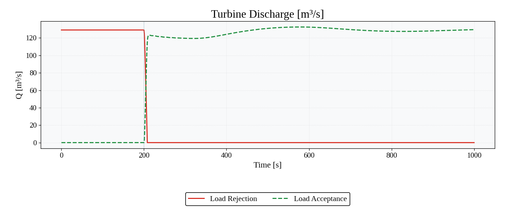

*Figure 20. Turbine discharge for load rejection (falls to zero) and load acceptance (rises to full).*

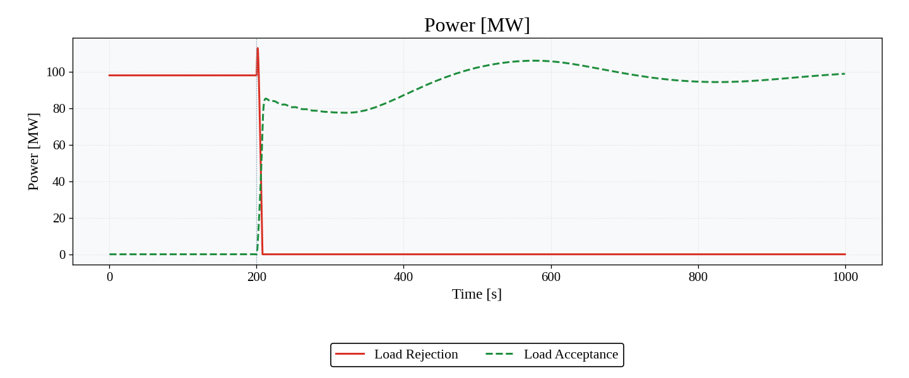

*Figure 21. Power output. The short rise above the rated value in load rejection is caused by the head rise.*

## 11.5 Load acceptance

The gate opens from 0 to 1 between 200 s and 208 s.

| Quantity (load acceptance) | Value |
|---|---|
| Lowest surge level | 435.11 m at 322 s |
| Highest surge level after the minimum | 452.32 m at 577 s |
| Final discharge (at 1000 s) | 129.52 m³/s |
| Lowest turbine head | 415.0 m |

The surge level falls by 15.9 m below its initial value of 451.0 m. Because the chamber was set up with a lower limit `H_min` of 200 m, there is no risk of emptying the chamber in this example. In a real design the lower limit would be the chamber floor or the tunnel crown.

The pressures stay positive: the lowest pressure in any pipe is 2.97 bar (tunnel), 3.74 bar (penstock) and 5.64 bar (branch).

## 11.6 Worst-case envelope

Combining both events:

| Section | *H* max [m] | *H* min [m] | *P* max [bar] | *P* min [bar] |
|---|--:|--:|--:|--:|
| Headrace tunnel | 467.5 | 435.1 | 6.80 | 2.97 |
| Penstock | 483.9 | 421.2 | 12.35 | 3.74 |
| Branch pipe | 490.1 | 415.0 | 13.00 | 5.64 |

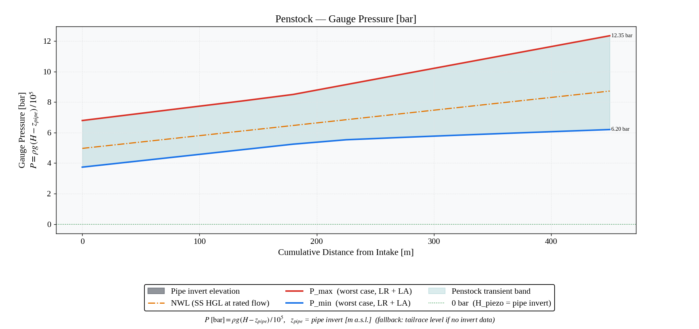

*Figure 22. Pressure envelope in the penstock.*

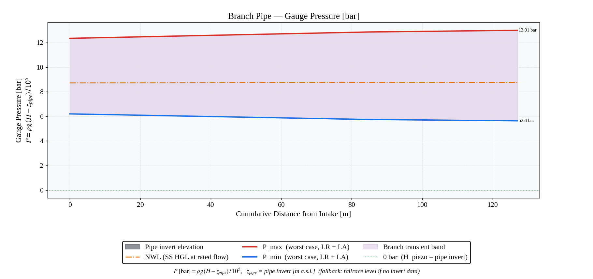

*Figure 23. Pressure envelope in the branch pipe.*

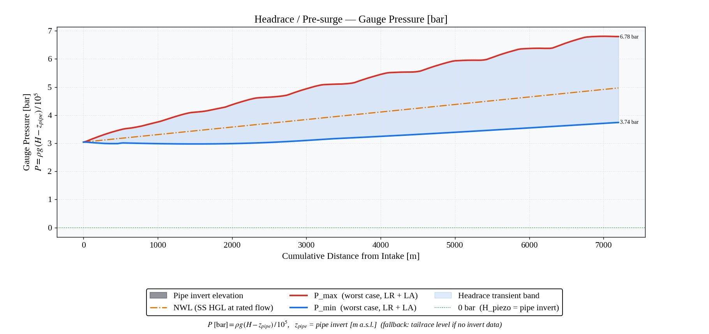

*Figure 24. Pressure envelope in the headrace tunnel.*

## 11.7 Head against time at selected points

The next figures show the head at three points of the tunnel and at three points of the penstock.

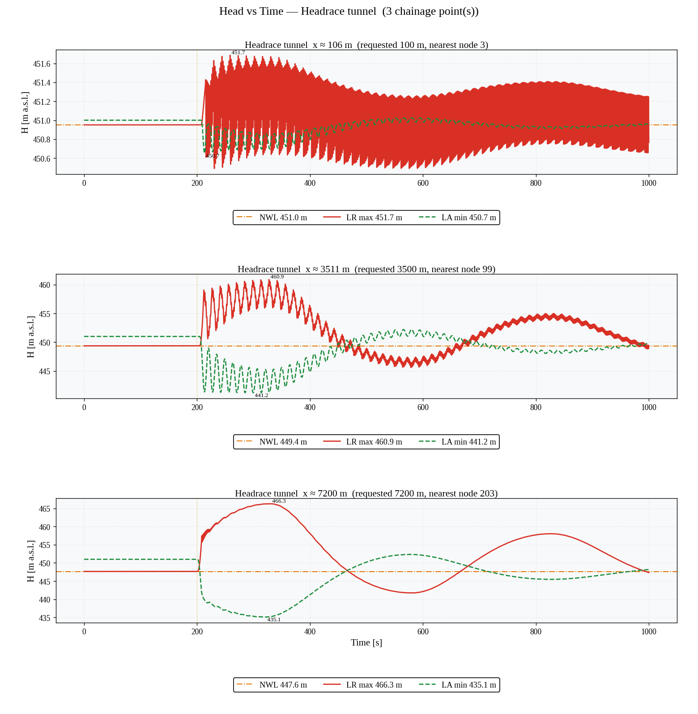

*Figure 25. Headrace tunnel: head against time at 100 m, 3500 m and 7200 m from the intake.*

At 100 m from the intake the head moves by only about ±0.6 m, because the reservoir fixes the head there. At 3500 m the head oscillates with a period of the order of 15 to 30 s (waves reflecting between the reservoir and the surge chamber; one full cycle is 4L/a = 29 s), and at the surge-chamber end it follows the slow chamber movement with almost no fast waves. This shows that the chamber works: it stops the water-hammer waves from travelling into the tunnel.

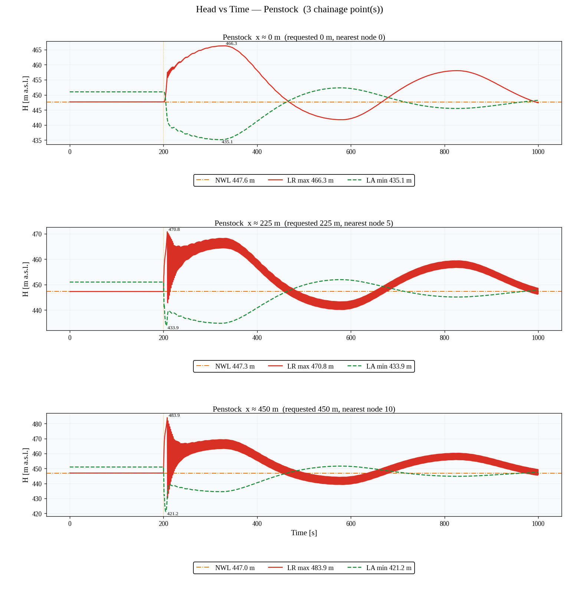

*Figure 26. Penstock: head against time at the start, middle and end.*

## 11.8 What the results tell the designer

1. **Penstock design pressure.** The maximum is 12.3 bar in the penstock and 13.0 bar in the branch. With a typical allowance for the design code, the steel wall must be checked for at least this value plus the allowance.
2. **No negative pressure.** The minimum pressure is about 5.6 bar or more in all pipes. There is no risk of vapour formation in the studied events.
3. **Chamber range.** The level swings between 435 m and 466 m. The chamber top must be above 466 m with a freeboard, and the bottom below 435 m.
4. **Tunnel.** The maximum head in the tunnel is 467 m, which is only 16 m above the reservoir level. The tunnel lining sees a low transient load.
5. **Check other events.** Partial rejection, emergency closure with a shorter time, and load acceptance from partial load must also be studied (see chapter 12 for the effect of closing time).

---

# 12. Sensitivity studies

The following studies change one input at a time in the reference model. They show how the results respond and help to choose design values. All runs use load rejection unless stated otherwise.

## 12.1 Orifice diameter

The orifice between the junction and the chamber is the most important design choice for damping.

| Orifice *D* [m] | Surge max [m] | Surge min [m] | Tunnel *P*max [bar] | Penstock *P*max [bar] | Branch *P*max [bar] | Branch *P*min [bar] |
|--:|--:|--:|--:|--:|--:|--:|
| 1.0 | 451.0 | 447.6 | 22.6 | 28.8 | 29.4 | -1.2 |
| 2.0 | 454.7 | 447.6 | 12.3 | 18.7 | 19.3 | 8.7 |
| 3.0 | 461.8 | 446.2 | 7.5 | 13.9 | 14.5 | 8.1 |
| 4.0 (design) | 466.3 | 441.7 | 6.8 | 12.4 | 13.0 | 6.6 |
| 5.0 | 468.3 | 438.6 | 7.0 | 11.9 | 12.5 | 6.1 |
| 6.0 | 469.2 | 436.9 | 7.1 | 11.9 | 12.3 | 5.9 |

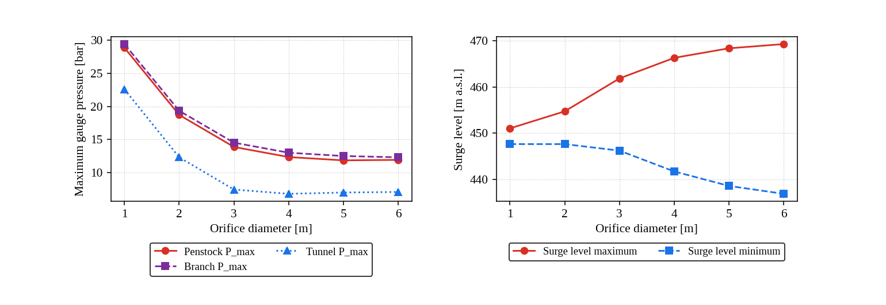

*Figure 27. Effect of the orifice diameter on the maximum pressures (left) and on the surge levels (right).*

**How to read this:**

- A **small orifice** (1 m) throttles the flow so strongly that the chamber hardly fills (451.0 m maximum). The chamber then acts almost like a closed end: the water-hammer wave reflects back into the penstock and the pressure reaches 28.8 bar in the penstock and 29.4 bar in the branch. The minimum pressure is even negative.
- A **medium orifice** (3–4 m) gives a good balance: moderate surge levels and pressures of 12.4–13.9 bar.
- A **large orifice** (6 m) lowers the pressure a little more (11.9 bar) but the surge extremes become larger (469.2 m / 436.9 m) and the damping is weaker.

The design choice (4 m) lies in the region where the pressure curve is already flat and the surge range is still moderate.

## 12.2 Closing time

The gate closing time controls the pressure rise in the penstock and branch.

| Closure time [s] | Tunnel *P*max [bar] | Penstock *P*max [bar] | Branch *P*max [bar] | Branch *P*min [bar] | Surge max [m] |
|--:|--:|--:|--:|--:|--:|
| 4 | 7.0 | 15.8 | 17.2 | 2.8 | 466.2 |
| 8 (design) | 6.8 | 12.3 | 13.0 | 6.6 | 466.3 |
| 16 | 6.8 | 11.0 | 11.3 | 8.4 | 466.3 |
| 32 | 6.8 | 10.7 | 10.8 | 8.5 | 466.4 |

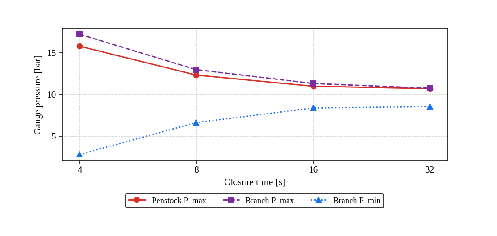

*Figure 28. Effect of the closure time on pressure in the penstock and the branch.*

**How to read this:**

- With a **4 s** closure the branch pressure is 17.2 bar. With **32 s** it is only 10.8 bar. The closure time is a powerful and cheap way to control pressure.
- The **tunnel** pressure and the surge levels hardly change, because they depend on the total water mass and on the chamber, not on the closure time.
- Very slow closures may not be allowed by the turbine governor or by speed-rise limits. Those limits are **not** modelled in version 6.

## 12.3 Tunnel wave speed

The tunnel wave speed is uncertain for rock-confined linings. Three values were tried.

| Tunnel *a* [m/s] | Tunnel *P*max [bar] | Penstock *P*max [bar] | Branch *P*max [bar] | Surge max [m] |
|--:|--:|--:|--:|--:|
| 800 | 6.81 | 12.33 | 12.98 | 466.29 |
| 1000 | 6.81 | 12.34 | 13.00 | 466.28 |
| 1200 | 6.80 | 12.35 | 13.01 | 466.27 |

The maximum pressures change by less than 0.3 %. The tunnel wave speed is therefore **not a sensitive input** in this layout, because the surge chamber isolates the tunnel from the fast waves. The penstock and branch wave speeds are more important.

## 12.4 Time step

See section 5.5. The results change by about 1 % to 3 % between the coarsest and the finest time step.

## 12.5 A short list of design hints from the studies

| Question | Answer from the studies |
|---|---|
| How can the maximum pressure be lowered? | Close more slowly; open the orifice up to 3–4 m |
| How can the surge range be reduced? | Use a bigger chamber area or a smaller orifice (but watch the pressure) |
| What is the risk of an orifice that is too small? | Water-hammer waves are reflected into the penstock and the pressure can be several bar higher |
| Does the tunnel wave speed matter? | Hardly, with a well-working chamber |
| Which time step for final checking? | 0.01 s or smaller |

---

# 13. Verification and validation

**Verification** asks "does the program solve the equations correctly?" **Validation** asks "do the equations describe the real plant?" This chapter covers verification. Validation needs field data (section 13.7).

## 13.1 Steady state before the event

Before the gate moves, the program must hold its initial values. Result for the reference model:

| Event | Maximum discharge drift before the event |
|---|---|
| Load rejection | 1.8 × 10⁻⁸ (relative) |
| Load acceptance | 1.3 × 10⁻⁴ m³/s (absolute) |
| Gate 0.5 → 0 | 1.8 × 10⁻⁶ m³/s |
| Gate 0.5 → 1 | 1.8 × 10⁻⁶ m³/s |

At the surge junction the head is the same on both sides (466.275 m), so there is no step in the water line.

## 13.2 Joukowsky check

For a very fast closure the first pressure rise must equal *a·ΔV/g*. The preset `Simple RPV` (one pipe, one turbine, no chamber) was run with a **step closure**.

| Quantity | Value |
|---|---|
| Wave speed *a* | 1250 m/s |
| Velocity *V* | 1.528 m/s |
| Joukowsky rise *aV/g* | 194.7 m |
| Initial head at the turbine | 98.2 m |
| Expected first peak | 292.9 m |
| Computed peak | 294.5 m (+0.5 %) |

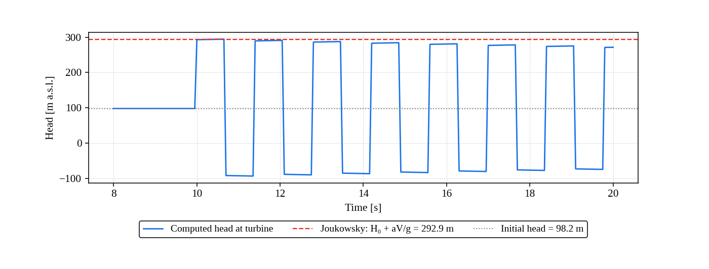

*Figure 29. Head at the turbine for an instantaneous closure compared with the Joukowsky value.*

The small excess comes from friction and from the finite time step.

## 13.3 Surge period

For a frictionless system the surge oscillation has the period

$$T = 2\pi\sqrt{\frac{L\,A_{\mathrm{eff}}}{g\,A_{\mathrm{tunnel}}}} = 2\pi\sqrt{\frac{7200 \times 469.3}{9.81 \times 56.75}} = 489.5\ \mathrm{s}$$

The simulated period (distance between the first two maxima) is 496.3 s, a difference of +1.4 %. Friction makes the real period slightly longer, so the agreement is as expected.

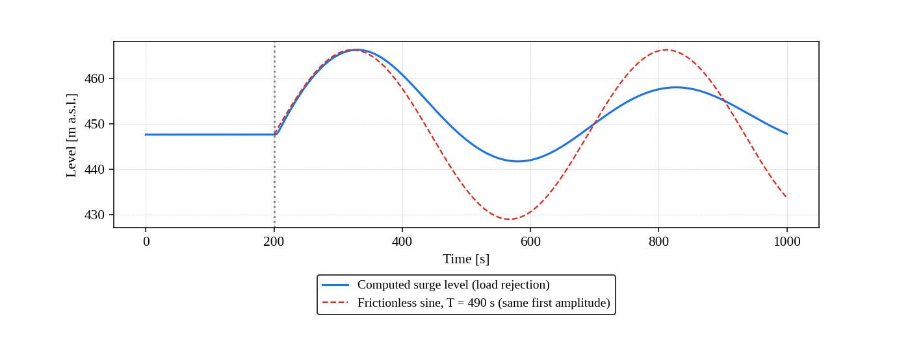

*Figure 30. Computed surge level compared with the frictionless sine wave of the analytical period.*

## 13.4 Thoma stability check

Thoma's criterion says that a chamber is stable for small oscillations if its area is larger than

$$A_{\mathrm{Th}} = \frac{L\,A_t}{2\,\alpha\,g\,H_{\mathrm{net}}}, \qquad \alpha = \frac{h_{f}}{V^{2}}$$

For the reference model, α = 0.648 s²/m, giving *A_Th* ≈ 375 m². The chamber has 469 m², which is 1.25 times the Thoma area. This is a screening check only; a final design uses safety factors and the full nonlinear simulation.

## 13.5 The version 5 defect: before and after

The reference model gave unbelievable results in version 5. The symptoms were:

- a wavy pressure envelope in the tunnel,
- a large jump in pressure between the tunnel end and the penstock start,
- negative pressure of about -6 bar in the penstock,
- maximum pressures of 20 bar.

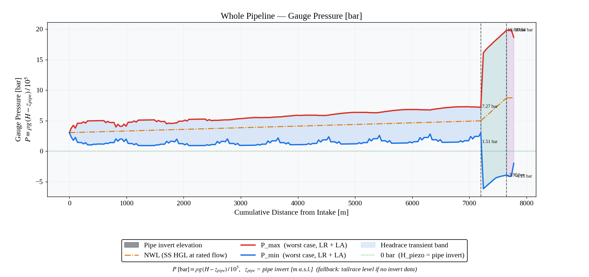

*Figure 31. Pressure envelope for the same model computed with the version 5 turbine boundary condition. Compare with the figure in section 10.4.*

**Cause.** At the first time step the turbine boundary condition returned a discharge of 158 m³/s instead of 129 m³/s and a head of 339 m, which is below the tailwater level of 361 m. The reason was a Newton iteration that clamped the net head at zero. When the first guess landed in the clamped region, the function had slope 1 and the iteration stopped at a wrong point. The pipe term *B·Q* is about 473 m here, which makes this likely.

The result was a strong start-up wave that was still present at 199 s, with the discharge at 177 m³/s and the head above 524 m before the event.

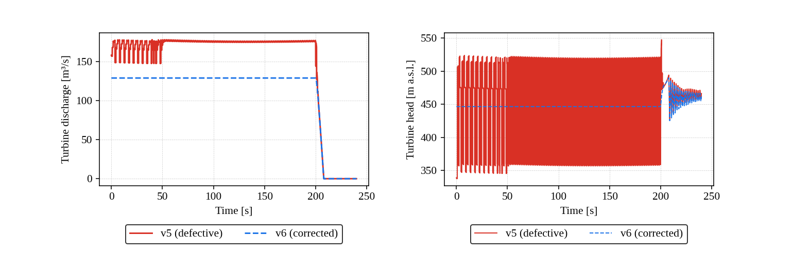

*Figure 32. Turbine discharge and head before and during load rejection, version 5 (red) and version 6 (blue dashed).*

**Fix.** The equation is quadratic and has an exact solution (section 6.6). Version 6 uses it. The discharge stays at 129.13 m³/s until the event.

## 13.6 Built-in presets

All five built-in presets were run in version 5 and version 6. The results are **identical**, because the old iteration worked for them.

| Preset | Components | Total *Q* [m³/s] | Net head [m] | Rated power [MW] | Max *P* [bar] | Min *P* [bar] |
|---|--:|--:|--:|--:|--:|--:|
| Molun Khola HPP | 8 | 14.0 | 92.2 | 11.6 | 13.8 | 0.49 |
| Simple RPV | 4 | 0.3 | 98.2 | 0.3 | 10.0 | 0.20 |
| Twin Penstock | 7 | 8.0 | 96.0 | 6.9 | 14.0 | -1.33 |
| Run-of-River (Pelton) | 6 | 2.5 | 492.2 | 11.2 | 63.8 | 0.49 |
| Pumped Storage | 8 | 30.0 | 294.0 | 81.3 | 28.6 | 0.49 |

The preset *Twin Penstock* shows a negative minimum gauge pressure. This is a result of that preset's data, not of the program.

## 13.7 What is not validated

No comparison with field measurements or a physical model is included in this document. Before using the program for final design:

1. Compare with a **measured load-rejection test** of a similar plant, if available.
2. Compare with an **independent code** for one or two cases.
3. Repeat the final run with a **smaller time step**.
4. Review the assumptions in chapter 14.

## 13.8 Regression test

`python tests/test_regression.py` runs load rejection and load acceptance for the reference model and checks:

- no model warnings,
- steady state before the event,
- pressures above zero,
- the same head on both sides of the surge junction.

Run this test after every change to the engine.

---

# 14. Assumptions, limitations and good practice

## 14.1 Physical assumptions

| # | Assumption | Consequence |
|---|---|---|
| 1 | Quasi-steady friction only | Fast waves are damped too little; after complete closure there is no flow and no friction damping |
| 2 | No cavitation, column separation or air release | Heads can fall below the pipe and even below absolute vacuum; step closure on the `Simple RPV` preset gives -93 m |
| 3 | Thin-wall elastic wave-speed formula | Not valid for rock-confined tunnels; enter the wave speed by hand |
| 4 | One time step for all pipes | The wave speed is adjusted to Δx/Δt (see table in section 5.1) |
| 5 | Turbine as an orifice with constant efficiency | No runner inertia, speed rise, governor, or efficiency curve |
| 6 | All units move together | No unit-by-unit rejection |
| 7 | Pelton uses the Francis law | No jet or deflector model |
| 8 | Explicit Euler for the surge level | Fine for the small time steps used |
| 9 | Flow cannot reverse through the turbine | No pump mode |

## 14.2 Software limitations

| # | Limitation |
|---|---|
| 1 | The `Valve` component is accepted but not simulated |
| 2 | Only the first turbine, the first manifold and the first surge chamber are used |
| 3 | The window's LR and LA buttons use fixed gate profiles (linear and cosine) |
| 4 | The envelopes are values at the nodes; peaks between nodes are not interpolated |
| 5 | Figures use the fonts installed on the computer (Times New Roman, then Liberation Serif, then others) |

## 14.3 Checklist before you trust a result

1. The Model Check dialog did **not** appear.
2. All invert elevations are entered.
3. The rated discharge is the **total** of all units.
4. The effective wave speeds are reasonable (Component Analysis table).
5. The surge levels are inside `H_min` / `H_max` (no warning).
6. The result does not change when Δt is halved.
7. The worst case of both events is used.
8. The closure time matches the real governor setting.
9. Negative pressures are treated as a **failure indicator**, not as a result.
10. The configuration file is saved with the report.

## 14.4 Troubleshooting

| Symptom | Likely cause | What to do |
|---|---|---|
| Model Check dialog | Inputs not consistent; wrong `Q_rated` | Check the rated discharge, the heads and the invert elevations |
| Very high or negative pressures right at 0 s | Initial state wrong | Check the component order and values; run the regression test |
| Surge level goes beyond the chamber limits | Chamber too small or limits wrong | Check `D_tank`, `n_tanks`, `theta_deg`, `H_min`, `H_max` |
| Pressure plot looks very different from expectation | Missing invert elevations | Enter `z_start`, `z_end` for every pipe |
| Time step message | Short pipe needs smaller Δt | Normal; accept it or lengthen the short pipe |
| Surge response looks flat | `theta_deg` too small | A very small angle gives a huge effective area |
| Pelton results look like Francis | Same discharge law | See section 6.6 |
| The valve has no effect | Valve not simulated | See section 14.2 |

## 14.5 Planned improvements (suggestions)

- Simulate the `Valve` component.
- Add turbine speed rise and a governor model.
- Add column separation (discrete vapour cavity model).
- Add unsteady friction.
- Allow more than one chamber and unit-by-unit events.
- Add a validation section with field data.

---

# Appendix A. Nomenclature

| Symbol | Meaning | Unit |
|---|---|---|
| *H* | Piezometric head | m a.s.l. |
| *Q* | Discharge | m³/s |
| *a*, *a_eff* | Wave speed (typed / used) | m/s |
| *A* | Flow area | m² |
| *D*, *D_h* | Diameter, hydraulic diameter | m |
| *L* | Pipe length | m |
| *f* | Darcy–Weisbach friction factor | – |
| *B* | Pipe impedance *a/(gA)* | s/m² |
| *R* | Pipe resistance *fΔx/(2gD_hA²)* | s²/m⁵ |
| *Δx*, *Δt* | Reach length, time step | m, s |
| *N* | Number of nodes of a pipe | – |
| *τ* | Gate opening | – |
| *H_rated*, *Q_rated* | Rated net head, total rated discharge | m, m³/s |
| *η* | Efficiency | – |
| *A_eff* | Effective surge-chamber area | m² |
| *K_in*, *K_out* | Orifice loss coefficients | – |
| *h_f* | Steady friction head loss | m |
| *C_P*, *C_M* | Characteristic constants | m |
| *Re* | Reynolds number | – |
| *ε* | Absolute roughness | m |
| *ν* | Kinematic viscosity | m²/s |
| *K*, *E* | Bulk modulus of water, Young's modulus of the pipe | Pa |
| *e* | Wall thickness | m |
| *P* | Gauge pressure (or power where stated) | bar (MW) |

# Appendix B. Glossary

| Term | Meaning |
|---|---|
| **Water hammer** | Fast pressure waves caused by a quick change of flow |
| **Surge** | Slow rise and fall of the water level in the surge chamber |
| **Piezometric head** | Height to which the water pressure would lift a water column, measured above sea level |
| **Invert** | Lowest point of the inside of a pipe or tunnel |
| **Gauge pressure** | Pressure above atmospheric pressure |
| **Wave speed** | Speed of pressure waves in the pipe |
| **Method of Characteristics** | Method to follow waves exactly by using the characteristic lines |
| **Node** | Calculation point on a pipe |
| **Courant condition** | Rule that a wave must travel exactly one reach per time step |
| **Quasi-steady friction** | Friction computed as if the flow were steady |
| **Load rejection** | Sudden loss of electrical load; gate closes |
| **Load acceptance** | Sudden demand for load; gate opens |
| **Manifold** | Junction that divides one pipe into several |
| **Orifice (surge)** | Narrow connection between tunnel and chamber that damps the oscillation |
| **Net head** | Head at the turbine inlet minus the tailwater level |
| **Envelope** | Highest and lowest values at each point during the whole run |
| **Cavitation** | Formation of vapour bubbles at very low pressure |
| **Thoma area** | Smallest chamber area for stable small oscillations |

# Appendix C. Reference configuration (JSON)

```json
{
  "components": [
    {
      "type": "Reservoir (Upstream)",
      "name": "Headwater",
      "H": 451.0,
      "z_base": 420.0
    },
    {
      "type": "Pipe",
      "name": "Headrace Tunnel",
      "L": 7200.0,
      "D": 8.5,
      "a": 1000.0,
      "n_mann": 0.015,
      "z_start": 420.0,
      "z_end": 397.0,
      "flow_type": "pressurised",
      "wave_mode": "material",
      "material": "Concrete (tunnel)",
      "thickness": 0.3,
      "anchored": true,
      "friction_method": "manual",
      "f_manual": 0.015
    },
    {
      "type": "Surge Chamber",
      "name": "Surge Pipe",
      "D_tank": 6.5,
      "n_tanks": 2,
      "D_orifice": 4.0,
      "K_in": 1.5625,
      "K_out": 2.0408,
      "H_min": 200.0,
      "H_max": 1000.0,
      "H_st_init": 0.0,
      "z_base": 397.0,
      "theta_deg": 8.13
    },
    {
      "type": "Pipe",
      "name": "Penstock",
      "L": 450.0,
      "D": 6.5,
      "a": 1300.8097959051624,
      "n_mann": 0.015,
      "z_start": 397.0,
      "z_end": 358.0,
      "flow_type": "pressurised",
      "wave_mode": "material",
      "material": "Steel",
      "thickness": 0.3,
      "anchored": true,
      "friction_method": "manual",
      "f_manual": 0.013
    },
    {
      "type": "Manifold",
      "name": "Manifold",
      "n_branches": 3,
      "z_invert": 358.0
    },
    {
      "type": "Pipe",
      "name": "Branch Pipe",
      "L": 127.0,
      "D": 3.75,
      "a": 1358.3502198282597,
      "n_mann": 0.015,
      "z_start": 358.0,
      "z_end": 357.5,
      "flow_type": "pressurised",
      "wave_mode": "material",
      "material": "Steel",
      "thickness": 0.3,
      "anchored": true,
      "friction_method": "swamee_jain",
      "f_manual": 0.0,
      "shape": "Circular",
      "wall_height": 0.0
    },
    {
      "type": "Turbine",
      "name": "Francis Turbine",
      "n_units": 3,
      "Q_rated": 129.13,
      "eta": 0.9022,
      "turb_type": "Francis",
      "z_centreline": 357.5,
      "n_gv": 20,
      "D_runner": 1.0,
      "n_jets": 1,
      "Cv_needle": 0.98,
      "D_jet": 0.15
    },
    {
      "type": "Reservoir (Downstream)",
      "name": "Tailrace",
      "H": 361.0,
      "z_base": 361.0
    }
  ],
  "sim": {
    "T_end": 1000.0,
    "dt": 0.05,
    "g": 9.81,
    "t_start": 200.0,
    "t_ramp": 8.0,
    "tau_init": 1.0,
    "tau_final": 0.0,
    "ramp_type": "Linear"
  }
}
```

# Appendix D. Result dictionary keys

| Group | Keys |
|---|---|
| Time series | `time`, `tau`, `H_junction`, `Q_pre`, `H_surge_tank`, `Q_surge_tank`, `H_penstock`, `Q_penstock`, `H_manifold`, `H_orifice`, `H_turbine`, `Q_turbine`, `net_head`, `power_MW` |
| Initial state | `H_up`, `H_dn`, `H0_junc`, `H0_ST`, `H0_net`, `Q0`, `P_rated_MW` |
| Geometry | `x_pre`, `x_post`, `x_bra`, `z_pre`, `z_post`, `z_bra` |
| Envelopes | `env_pre_max`, `env_pre_min`, `env_post_max`, `env_post_min`, `env_bra_max`, `env_bra_min` |
| Steady water line | `nwl_pre`, `nwl_post`, `nwl_bra` |
| Chainage | `chainage_x_pre`, `chainage_H_pre`, `chainage_x_post`, `chainage_H_post`, `chainage_x_bra`, `chainage_H_bra` |
| Tables and messages | `component_analysis`, `surge_warnings`, `model_warnings` |

# Appendix E. Change log, version 5 → version 6

| # | Change | Effect |
|---|---|---|
| 1 | Turbine boundary condition solved in closed form | No false start-up wave; no false negative pressures |
| 2 | Friction, impedance, head loss and rated head taken at the rated discharge | Load acceptance no longer uses laminar friction; the same rated head for both events |
| 3 | Closed-form starting discharge for any initial gate opening | Partial-gate events start in equilibrium |
| 4 | Wave-speed mode honoured; unknown materials warn; "Concrete (tunnel)" added | Typed wave speeds are no longer silently replaced |
| 5 | Automatic steady-state check and Model Check dialog | Bad inputs are flagged |
| 6 | Figures: black Times New Roman, larger fonts, legends below plots, smaller labels inside plots | Report-ready figures |
| 7 | Version 6.0.0, regression test and reference file | Repeatable checks |

# Appendix F. Quick-start cheat sheet

1. `python main.py`
2. *File → Import Config JSON* → choose `tests/yogesh_config.json`.
3. Check *Run and Summary*: `T_end = 1000`, `dt = 0.05`, `t_start = 200`, `t_ramp = 8`.
4. Press **RUN Analysis (LR + LA)**.
5. *Results → Pressure Envelope → Whole pipeline → Pressure [bar]*.
6. *Results → Component Analysis*: check wave speeds and pressures.
7. *Export CSV* and *Save summary*.
8. *File → Export Config JSON* to save your model.

# Appendix G. References

- Wylie, E. B. and Streeter, V. L., *Fluid Transients in Systems*, Prentice Hall.
- Chaudhry, M. H., *Applied Hydraulic Transients*, Springer.
- Jaeger, C., *Fluid Transients in Hydro-Electric Engineering Practice*, Blackie.
- Swamee, P. K. and Jain, A. K. (1976), "Explicit equations for pipe-flow problems", *Journal of the Hydraulics Division, ASCE*, 102(5).
- Thoma, D. (1910), *Zur Theorie des Wasserschlosses bei selbsttätig geregelten Turbinenanlagen*.
- Joukowsky, N. (1898), "Über den hydraulischen Stoss in Wasserleitungsröhren".
